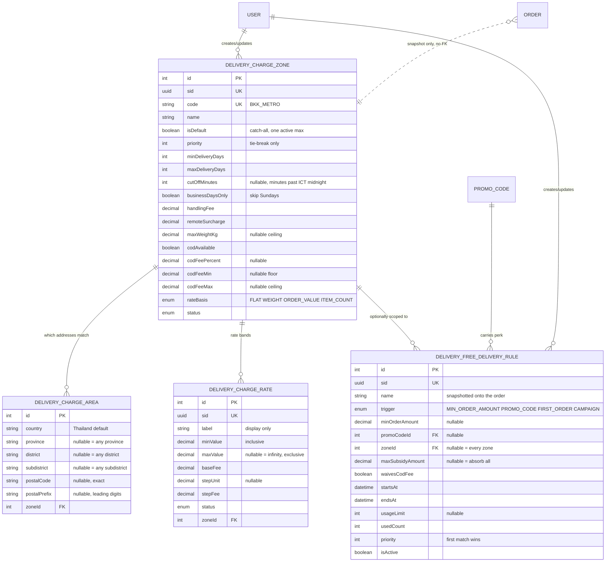
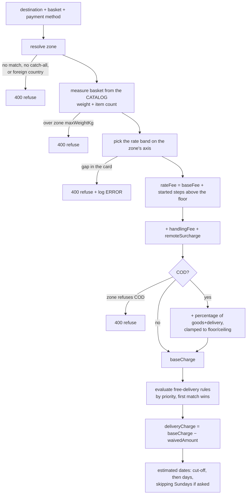

# Delivery Charge Module (Shipping Rate Card)

What the **merchant charges the customer** to ship an order, and when that charge is waived: `DeliveryChargeZone` (a priced destination tier — Bangkok Metro, Central, Upcountry, Remote), `DeliveryChargeArea` (which addresses fall into a zone), `DeliveryChargeRate` (the non-overlapping rate bands inside a zone), and `DeliveryFreeDeliveryRule` (the waiver layer).

> **Not the same thing as the `delivery` module** (`delivery.prisma`, `docs/delivery.md`). That one is the third-party courier directory — what a courier charges **us** and where a parcel physically is. This one is a **pricing** domain: what the storefront quotes. Merging them would mean a courier renegotiation silently repricing the shop.
>
> | | `delivery` module | `delivery-charge` module (this one) |
> |---|---|---|
> | Answers | Who carries the parcel, where is it | What does the customer pay for delivery |
> | `DeliveryZone.baseFee` vs `DeliveryChargeRate.baseFee` | our **cost**, renegotiated with a courier | the customer's **price**, a merchandising decision |
> | Changes when | a contract is renewed | marketing runs a promotion |

Schema source: `prisma/schema/delivery-charge.prisma` (models `DeliveryChargeZone`, `DeliveryChargeArea`, `DeliveryChargeRate`, `DeliveryFreeDeliveryRule`; enums `DeliveryChargeStatus`, `DeliveryRateBasis`, `FreeDeliveryTrigger`).
Module source: `src/modules/delivery-charge/` — plus the two touch-points in `src/modules/order/` noted under [Where the quote route lives](#where-the-quote-route-lives).
Migration: `prisma/migrations/20260823100000_add_delivery_charge_domain/`.
Seed: `prisma/seed-delivery-charge.ts` (`npm run db:seed-delivery-charge`).

---

## What this replaced

Until this module, the delivery fee was a TypeScript constant:

```ts
// order.service.ts, now removed
const FLAT_DELIVERY_CHARGE = 50;
```

…applied to every order regardless of destination, weight or basket size. The cart page separately hardcoded `฿5`, so the number the customer saw was wrong by an order of magnitude on every single order. Neither could express "free over ฿1,000", charge more to reach an island, or be changed without a deploy.

---

## DB Schema

### Entity-Relationship Diagram



### Conventions

* **Money** is THB, `Decimal(12, 2)`, matching `Order`'s pricing columns. **Weight** is kg, `Decimal(10, 3)`, matching `Product.weight`.
* **The rate basis belongs to the zone, not to a band.** One zone prices on one axis and its bands are the segments along it. Letting bands under one zone disagree on the unit would make "which band applies" unanswerable.
* **Bands are half-open, `[minValue, maxValue)`.** Exactly 1.0 kg belongs to the 1–3 band and not to both.
* **NULL is a wildcard, never a requirement to be null.** `{ province: null }` on an area rule claims the whole country; it does not mean "addresses with no province".
* **There is no "exclude" flag.** Carving Koh Samui out of Surat Thani is done by putting its postal code in the REMOTE zone — a more specific rule always beats a less specific one, so the exclusion falls out of the matching ladder instead of needing a second mechanism.

### Constraints the database enforces itself

Everything the database can enforce, it does — application checks exist on top for better error messages, not instead.

| Constraint | Stops |
|---|---|
| `delivery_charge_rates_no_overlapping_bands` (GiST `EXCLUDE` over `numrange`, `WHERE status = 'ACTIVE'`) | Two active bands in one zone overlapping, which has no defined "which band wins" — the bug would be invisible, since the customer is simply charged whatever row the planner returned first |
| `delivery_charge_zones_one_active_default` (partial unique) | Two catch-all zones, which would make resolution order-dependent. Scoped to `ACTIVE` so a replacement default can be staged and swapped in |
| `delivery_free_delivery_rules_trigger_inputs_check` | A rule that can never fire (a `MIN_ORDER_AMOUNT` with no threshold), or one carrying a condition its trigger never evaluates |
| `delivery_charge_areas_rule_unique` (COALESCE-based) | Duplicate area rules. A plain column-list unique cannot: Postgres treats NULLs as distinct, so `('Thailand', NULL, NULL, NULL, NULL, NULL)` would otherwise be insertable twice |
| `delivery_charge_areas_postal_exclusive_check` | A rule setting both `postal_code` and `postal_prefix` — two spellings of one axis, claiming a precision it does not have |
| `delivery_charge_areas_district_needs_province_check` | A district named without its province, which would match every same-named district in the country |
| `delivery_charge_areas_subdistrict_needs_district_check` | A subdistrict named without its district — the same hole one level down |
| `orders_delivery_charge_base_check` | A waiver that *increases* the fee, which would make the margin report read the subsidy as negative |

`btree_gist` is created by the migration (as `pg_trgm` already was in `20260817130000`).

---

## How a charge is calculated

All of it runs in `DeliveryChargeService.calculateQuote`, which is the **only** place a delivery fee is ever produced. The checkout preview and `OrderService.placeOrder` both call it — that is what makes "the price you were quoted is the price you were charged" a property of the code rather than of two implementations agreeing.

The rules themselves are pure functions in `delivery-charge.calculator.ts` — no Prisma, no Nest, plain numbers in and out — so they are exercisable in `delivery-charge.calculator.spec.ts` without a database.



### 1. Zone resolution — the specificity ladder

Each candidate area rule is scored; the zone keeps its best rule; the highest score across zones wins, with `priority` then `id` settling genuine ties.

| Score | Rule shape |
|---|---|
| 1000 | exact postal code |
| 950 | province + district + subdistrict |
| 900 | province + district |
| 800 + prefix length | postal prefix (so `101` outranks `10`) |
| 600 | province alone |
| 100 | country alone |

Gaps between rungs are deliberate — a new rule class can be slotted in without renumbering what is already in production.

If nothing matches, the **catch-all** zone (`isDefault`) applies — but only if the rate card mentions the destination's country at all. Without that gate a Thailand card would price a Malaysian address off its upcountry bands and promise a 2–4 day domestic lead time for a parcel that has to clear customs. With no coverage and no catch-all, the address is **refused**. Refusing is the important half: the alternatives — charging the cheapest zone's price, or charging nothing — both ship a real parcel at a price nobody chose.

### 2. Basket measurement

Weight and item count are read from the **catalog**, never from the request. A client-supplied weight is a client-supplied price on a weight-based zone, which would let anyone check out 20 kg at the 0–1 kg rate.

A combo weighs the sum of its components (it holds no weight of its own, same as it holds no stock of its own). Anything the catalog has no weight for falls back to `DEFAULT_ITEM_WEIGHT_KG` (0.5) rather than to zero — a whole basket of unweighed items must not price into the cheapest band and ship at a loss.

### 3. Rate band

`baseFee` covers landing in the band. `stepFee` then charges for each **started** `stepUnit` above `minValue`, which is how couriers actually round: 10.1 kg on a "10 kg+, ฿150, then ฿15/kg" band is ฿165, not ฿151.50.

A metric that falls in a gap in the card is a **configuration bug**: it is logged at ERROR with the zone and metric, and the customer is refused. Silently charging 0 is the one outcome that costs real money and that nobody notices.

### 4. COD fee

A percentage of the amount the courier collects **at the door** — goods *plus* delivery, since that is what the customer hands over — clamped to the zone's floor and ceiling. `codFeeMin` is a floor on a fee that exists, not an instruction to invent one: a zone with no percentage charges nothing for COD. A zone with `codAvailable = false` refuses COD outright.

### 5. Free delivery

Rules are evaluated in `priority` order and **the first match wins — they do not stack**. Stacking waivers on one fee has no meaning (the second has nothing left to waive) and would make "why was this free" unanswerable on the order record.

| Trigger | Extra condition (on top of window, zone scope and usage cap) |
|---|---|
| `MIN_ORDER_AMOUNT` | basket reaches `minOrderAmount` |
| `PROMO_CODE` | the customer applied the linked coupon |
| `FIRST_ORDER` | logged-in, and no previous non-cancelled order. Never fires for a guest — otherwise the perk is free to farm by checking out logged out |
| `CAMPAIGN` | the window itself is the whole condition |

**The threshold is measured on the goods total after item discounts *and* after the coupon.** Measuring pre-coupon would let a customer stack a percentage coupon onto a basket that only reached the threshold because of the pre-discount price. It is also the number shown on the summary row, which is what they will argue from.

`maxSubsidyAmount` caps what the merchant absorbs; the customer pays the remainder ("free delivery up to ฿60" on a ฿90 fee is a ฿30 charge, not a refused waiver). The COD fee is only in the waivable pool when the rule opts in — it is a cash-handling charge, not delivery.

While walking the list, the service also tracks the **nearest unmet** threshold and returns it as `freeDeliveryProgress`. That powers the "spend ฿240 more" nudge, and the client could not compute it at any price: it would need every rule and every zone scope.

### 6. Estimated dates

Bangkok is UTC+7 with no DST ever, so a fixed offset is exact rather than an approximation — no tz database involved.

* **Dispatch cut-off.** An order after `cutOffMinutes` (minutes past ICT midnight) starts counting tomorrow. The same 2–3 day zone quotes different dates at 15:59 and 16:01 with nothing reconfigured — that is the cut-off working, not a bug.
* **Sundays**, when `businessDaysOnly` is set. Thai couriers work Saturdays, so Sunday is the only non-working day modelled; a five-day week would push every upcountry promise out by a day it does not need.

The returned instants are Bangkok midnight, which is what a `timestamptz` column wants for "this calendar day in Thailand". `estimatedDeliveryText` ("1-2 days") is pre-formatted server-side so every surface renders it identically.

---

## Where the quote route lives

`POST /order/delivery-quote` — on the **order** controller, not this one.

Quoting needs live catalog prices to work out the basket total a threshold rule is measured against, and only `OrderService.resolveCartLine` knows what that is. Putting the route on `DeliveryChargeController` would mean either duplicating price resolution or a circular module dependency (`DeliveryChargeModule` ↔ `OrderModule`). **Delivery-charge owns the rules; order owns the basket.** `OrderModule` imports `DeliveryChargeModule` and never the reverse, so there is no `forwardRef` anywhere.

---

## API End Points

### Storefront

| Method | Path | Auth | Notes |
|---|---|---|---|
| `POST` | `/order/delivery-quote` | Public, optional JWT | The checkout preview. Throttled 30/min per IP |
| `GET` | `/delivery-charge/free-delivery-threshold` | Public | The banner's "free delivery over X". Site-wide rules only |

### Admin (`ADMIN`, `MANAGER`)

| Method | Path | Notes |
|---|---|---|
| `GET` | `/delivery-charge/nationwide-flat-rate` | The one-charge-everywhere rate, plus what overrides it |
| `PUT` | `/delivery-charge/set-nationwide-flat-rate` | Set it. Idempotent create-or-update |
| `POST` | `/delivery-charge/create-zone` | Zone + areas + rates in one call |
| `GET` | `/delivery-charge/all-zones` | Paginated, sorted by `priority` |
| `GET` | `/delivery-charge/zone/:id` | |
| `PATCH` | `/delivery-charge/update-zone/:id` | Scalars merge; `areas`/`rates` replace wholesale |
| `DELETE` | `/delivery-charge/delete-zone/:id` | Refused while the zone is the catch-all |
| `POST` | `/delivery-charge/create-free-delivery-rule` | |
| `GET` | `/delivery-charge/all-free-delivery-rules` | Paginated, sorted by `priority` — the order they actually run in |
| `PATCH` | `/delivery-charge/update-free-delivery-rule/:id` | |
| `DELETE` | `/delivery-charge/delete-free-delivery-rule/:id` | |

`MARKETING` is deliberately excluded from the admin surface even though free delivery is a promotion: unlike a promo code, a free-delivery rule can be scoped to a destination zone, and a badly-scoped one loses money on every order to that zone silently rather than being redeemed a countable number of times.

### One charge for the whole country

The simplest rate card there is, and for most shops the only one they need. `PUT /delivery-charge/set-nationwide-flat-rate` takes a fee, a delivery-time promise and the COD settings — no zones, no coverage rules, no bands — and builds the rest itself:

```
DeliveryChargeZone {
  code: "NATIONWIDE"     reserved, so the endpoint can be a genuine upsert
  isDefault: true        catches every address no other zone claims
  rateBasis: FLAT
  areas: []              none, deliberately — see below
  rates: [{ minValue: 0, maxValue: null, baseFee: <charge> }]
}
```

Three decisions worth stating:

* **It is its own endpoint, not a documented way to hand-assemble `create-zone`.** "Set one price for the country" should not require an admin to know what a catch-all zone is, or which fields must be left *empty* to make one work.
* **No area rules.** A country-wide wildcard row would score 100 against every address and be indistinguishable from the fallback the zone already is. `isDefault` is the whole mechanism.
* **`PUT`, not create-then-edit.** The screen has one save button and no idea whether the zone exists yet; making it find out first would be a race against a second admin pressing the same button.

Nothing in the calculator branches on the `NATIONWIDE` code, so a shop can start here and later add a REMOTE zone beside it without migrating anything.

**`overridingZones`** is the honest half of the response. The nationwide rate is the catch-all, so it only reaches addresses no *other* zone claims — a shop with a four-zone Thailand card that then sets a flat ฿50 would have that ฿50 apply almost nowhere. The `GET` returns the overriding zones **by name** so the admin screen can say so instead of showing a fee that looks in force and mostly is not.

**`exclusive: true`** deactivates every other zone so the one price really does apply everywhere. Zones are set `INACTIVE`, never deleted — they keep their coverage rules and rate cards and can be switched back on, which makes it a reversible decision rather than a destructive one.

### Why zone `areas`/`rates` replace wholesale

Both are sets with no stable client-visible identity, edited as a grid and saved as a grid. Asking the client to diff a rate card into per-row create/update/delete calls would put the burden of keeping it consistent — no gaps, no overlaps, exactly one open-ended band — where it cannot be enforced. Replacing the whole set inside one transaction means the card is never half-migrated and the overlap constraint only ever sees the finished state.

The cost is that rate `sid`s are not stable across an edit. That is acceptable precisely because nothing references them: orders snapshot the fee they were charged, never the band that produced it.

---

## Security

| Concern | How it is handled |
|---|---|
| Client dictating its own delivery fee | There is no field to send one and no signed quote to replay. `placeOrder` recomputes from the same rules inside its own transaction and charges that — a tampered preview changes what is *displayed* and nothing that is billed. This is why the preview can safely be public |
| Client dictating basket weight | Weight and item count are read from the catalog, never the request |
| `addressId` enumeration | Resolved through `AddressService`, which enforces ownership. Guests are refused it outright — they have no address book, so an id they send can only be someone else's |
| Quote endpoint abuse | Unauthenticated by necessity (guests check out), and both a price oracle and the most DB-expensive public read in the app. `@Throttle` 30/min per IP — far above a human editing an address form, far below a useful scrape rate. No `blockDuration`: unlike the auth routes this is not a credential-guessing surface |
| Payload size | `MAX_QUOTE_ITEMS` caps distinct lines. Quote cost scales with rows looked up, not units on them |
| Free-delivery campaign drained by previews | Quoting is strictly read-only. A use is claimed only at placement — a preview that burned one would exhaust a 500-order campaign in an afternoon with no orders placed |
| Two orders racing for the last free delivery | `claimRuleUsage` runs `usedCount < usageLimit` **inside** the UPDATE, the same guarded bump `PromotionRepository` uses for promo codes. The loser matches zero rows and the order is re-priced without the waiver |
| Pricing edited mid-placement | `calculateQuote` accepts the caller's `tx`, so placement prices against the card visible inside its own transaction |
| Admin writes unattributed | `createdBy`/`updatedBy` on zones and rules, `SetNull` on user deletion — same contract as `Product`/`ComboProduct` |

---

## The order snapshot

`Order` gains eight columns (all nullable or defaulted, so existing orders migrate untouched):

| Column | Why |
|---|---|
| `deliveryZoneCode` / `deliveryZoneName` | Which zone priced it |
| `deliveryChargeBase` | The fee **before** any waiver. `deliveryChargeBase − deliveryCharge` is what the promise cost the merchant, and it is not recoverable any other way: a zero fee from a waiver and a zero fee from a free zone are the same number |
| `deliveryCodFee` | Broken out so a COD refund knows what is and is not refundable |
| `freeDeliveryApplied` / `freeDeliveryRuleName` | The customer-facing reason, frozen. Lets an invoice render "Delivery ฿80 / Free delivery over ฿1,000 −฿80" years later |
| `estimatedDeliveryFrom` / `estimatedDeliveryTo` | The promise made **at checkout** — distinct from `DeliveryShipment.estimatedDelivery*`, which is what the courier promised when the parcel was booked. When they disagree, this is what the customer was told |

There is deliberately **no FK** to `DeliveryChargeZone` or `DeliveryChargeRate`. The rate card is edited constantly, and a live join would make a six-month-old receipt re-explain itself with today's prices. Same snapshot contract as `OrderItem`'s product columns.

---

## Admin UI

Two tabs on **Set Up**, after the existing Delivery Man / External Delivery Service pair. They sit next to the courier directory and are easy to confuse with it, so the tab file says which is which: *External Delivery Service* is who carries the parcel and what the courier charges **us**; *Delivery Charge* is what we charge the **customer**.

Client module: `src/modules/deliveryCharge/` (`admin/`, `schemas/`, `types/`), following the same `admin` + `schemas` + `types` layout as `modules/promotion` and `setUp/externalDelivery`.

**Set Up → Delivery Charge**

* `NationwideFlatRate` — the country-wide charge as a card, first on the page because it is the answer for most shops. Shows the fee, the lead time, whether COD is taken, and what it applies to. Renders a `฿0` charge as **"Free"**, since zero is a deliberate setting here and not an unset field. When other zones override it, they are listed **by name** in an amber notice — "2 zones override this" is not actionable, "Bangkok Metropolitan, Remote & Islands" is.
* `SetNationwideFlatRate` — the modal behind it. The dispatch cut-off is a native time picker; `toMinutes`/`toTimeString` convert to the minutes-past-midnight the server stores, so no admin ever types `960`. The `exclusive` switch is **never pre-ticked** — it deactivates other zones, which is a real pricing change that has to be a deliberate click each time, not a setting that persists into the next edit.
* `DeliveryCharge` — the card plus the zone table. Any change to either refetches **both**: they describe one rate card from two angles, so refreshing one alone leaves the other claiming something that is no longer true.
* `AddDeliveryZone` / `EditDeliveryZone` / `DeliveryZoneFields` — the full editor, with `useFieldArray` rows for coverage rules and rate bands. Both forms share one field component and one payload builder because both submit the *whole* zone.

**Set Up → Free Delivery** — `FreeDelivery`, `Add`/`EditFreeDeliveryRule`, `FreeDeliveryRuleFields`. The trigger drives which inputs are on screen: an always-visible "minimum basket" box would be a field that silently fails the save, since the server rejects a rule carrying an input its trigger never evaluates.

Two conventions worth noting, both departures from the surrounding admin screens and both deliberate:

* **No dirty-field diffing on either editor.** `EditPromoCode` and `EditExternalDelivery` patch scalars, where "unchanged" and "omitted" mean the same thing. A zone carries two *sets* whose update semantics are replace-wholesale, so a diff would have to guess whether an untouched grid means "leave it" or "clear it". A rule's legal inputs depend on its trigger, so a diff could send a new trigger without clearing the old input and be rejected by a CHECK constraint. Sending the complete form makes both questions disappear.
* **`usePut`** was added alongside `usePost`/`usePatch` for the nationwide endpoint — a replace-or-create where the caller sends the whole resource and does not need to know whether it exists yet.

`IInputField`'s type union gained `"time"`. `InputField` already passes `inputType` straight through and only special-cases `"number"`, so a time value needs no handling — it is a string like any other.

### Coverage is picked, not typed

The three named levels of a coverage rule come from `useThaiGeography()` — the same 77-province / 921-district / 7,436-subdistrict dataset the checkout address form uses, cascading province → district → sub-district, submitting the same canonical **English** names.

This is not a convenience. Zone matching compares an admin's rule against a customer's stored address, case- and whitespace-insensitively but not slug-insensitively. A hand-typed `"Bangkok "`, `"bangkok"`, `"Krung Thep"` or `"Chiang mai"` produced a rule that matched **nothing** — and failed *silently*, by never winning the ladder rather than by erroring. The order simply priced off the catch-all, so a typo looked like a pricing bug. Sharing one dataset across both sides removes the class of defect.

Details worth keeping:

* **The wildcard is still an empty string.** Radix refuses a `SelectItem` with value `""`, so each dropdown carries an "Any …" entry under a private `__ANY__` sentinel that `onSelectionChange` immediately rewrites back to `""`. The sentinel never leaves `CoverageAreaRow` — the form value, the schema and the payload only ever hold a real name or `""`.
* **Choosing a level clears the ones below it.** A district left behind from the previous province would be saved as a real rule, and a district that is not in its province matches nothing. The server cannot catch it: both names are individually valid.
* **District and sub-district are disabled until their parent is set**, mirroring the two DB check constraints rather than offering an empty list that reads as missing data.
* **Each row is its own component.** The rows are a field array and every row runs an independent cascade, so the watches cannot live in a `.map` body.
* **Postal Code stays a typed field** — one exact value, not a choice from a cascade — but it is validated against the dataset's **956 real postal codes**, not against `\d{5}`. Five digits admits 90,000 strings of which ~99% do not exist, and a code that does not exist fails in exactly the same silent way a mistyped province did. `isKnownPostalCode()` is deliberately synchronous so the zod schema can call it, reading the same module cache `loadGeography()` fills, and **fails open** when the dataset has not loaded — any form asking the question also renders the dropdowns, so the cache is warm by submit time, and treating "not loaded" as invalid would block a save over a slow chunk fetch.
* **A zone must narrow, or it is not a zone.** Two rules, both enforced in the zod schema and in the service: every coverage rule has to name a province or a postal code, and a zone that is not the catch-all needs at least one of them. A rule naming nowhere covers everywhere — which is what the catch-all does and what the nationwide charge screen is *for* — so a zone carrying one is a second country-wide price wearing a region's name. A zone with no rules at all matches nothing and prices nothing; the admin table already had to label that "never matches". The catch-all is the deliberate exception on both counts, since it carries no rules precisely because it is the fallback. On update the coverage check runs only when the edit actually sends `areas`, so clearing `isDefault` on an older zone stays reachable. The array-level "at least one" error is rendered in the coverage section's empty state — nothing else owns that field, and without it the save would fail silently.
* **Only one active zone may cover a whole country.** A coverage rule carrying nothing but a country matches every address in it at rung 100, so two of them tie on *every* order and the winner falls to `priority`, then `id` — an answer nobody chose and nothing on screen explains. `assertOneZonePerWholeCountry` refuses the second on create and on update, naming the zone already holding it. The check runs per country, case-insensitively, and skips `INACTIVE` zones (they price nothing, so they cannot tie); on update it excludes the zone being edited and falls back to that zone's stored areas when the edit does not send any. The **catch-all is deliberately exempt** — it holds no area rules, so it never ties; it applies only where nothing matched, which is exactly why a country-wide rule makes it unreachable and why the nationwide card says so itself. In the form, an untouched coverage row now states its claim — *"Covers the whole country — only one zone can do that"* — because that row saving as a country-wide rule is how two zones quietly end up covering the same ground.
* **A zone can be retired with the "Zone is active" switch — except the catch-all.** The status column was displayed and the DTO accepted it, but nothing in the form ever wrote it. The switch maps to the `DeliveryChargeStatus` enum in `buildZonePayload`; an on/off fact does not need a two-option dropdown. Deactivating the catch-all is refused by `updateZone` with the **same 409 as deleting it**, because the fallback lookup only considers `ACTIVE` zones — so retiring it would refuse every address no other zone covers, and without this guard the delete block was bypassable by setting `status` instead. The form shows the reason before the save is attempted rather than relying on the round-trip.
* **A zone band cannot be priced at 0, and the charge is never pre-filled.** The Add form used to seed `baseFee: 0`, so a zone saved without the charge ever being touched — and shipped every order in it free. A zero band also records `฿0.00` on the order with `freeDeliveryApplied = false` and no rule name, so nothing on the order says *why* it was free. A deliberate waiver is a `DeliveryFreeDeliveryRule`, which is scopeable to one zone via `zoneId` and is snapshotted onto the order. Enforced in the zod schema and by `@Min(0.01)` on `DeliveryRateInputDto.baseFee`; `useFieldArray.append` demands the whole field shape, so a new band spells the absence out rather than omitting it. **The nationwide flat rate is the deliberate exception** — it does not go through this DTO, and `0` there is an explicit labelled choice ("enter 0 to deliver free everywhere") rendered as **Free** on the card.
* **A rule names a place *or* a postal code, never both.** `scoreArea` reads a postal rule and returns immediately, so the named levels on that row are never consulted — `{ province: 'Amnat Charoen', postalCode: '10110' }` is not a narrower rule, it is a rule about a *Bangkok* postcode wearing the wrong province. The form disables whichever half is unused; `assertAreaRulesAreCoherent` rejects it server-side on both create and update, naming the row and saying which half to drop. A row saved before the rule existed can hold both, so a **conflicted row stays fully editable** and shows an amber explanation — disabling on "the other side is set" would lock every control and leave deleting the row as the only way out.
* **Postal Prefix is not on screen** (see below). A row that still carries one — the seeded `BKK_METRO` covers Bangkok with a `10` prefix — renders a read-only line saying so. Without it that row would show three "Any" dropdowns and an empty postal box, i.e. a whole-country wildcard, which is the opposite of what it claims.
* `ISingleSelectSearch` gained `placeholderText`, defaulting to `labelName`. A repeating row labels only its first entry, so the trigger would otherwise render blank on rows 2+.

`delivery.prisma`'s `DeliveryZone` — the *external courier* directory — needs none of this. Its `province`/`district`/`postalCodePrefix` were already Thai-named, so the address taxonomy change did not touch it, and its admin form only ever collects the `areaName` display label. Those columns have no reader today; adding a `subdistrict` to match `Address` would be a column with no consumer.

### Deferred admin fields

Fifteen inputs are commented out of the two zone-facing forms, to keep the day-one screens short. **Commented, never deleted** — the columns, the DTOs, the zod schemas, the payload builders and the calculator all still handle them, so restoring one is uncommenting a block, not rebuilding a feature. Each block carries a `FUTURE FEATURE — HIDDEN, NOT REMOVED` marker.

| Form | Hidden | Still on screen |
| --- | --- | --- |
| `SetNationwideFlatRate` | Dispatch Cut-off, Max Order Weight, COD Fee %, COD Fee Min, COD Fee Max | Charge, Min/Max Delivery Days, Skip Sundays, Accept COD, "only delivery charge" |
| `DeliveryZoneFields` | Thai Name, Charge Based On, Postal Prefix, Dispatch Cut-off, Handling Fee, Remote Surcharge, Max Order Weight, COD Fee %, COD Fee Min, COD Fee Max | Zone Name, Zone Code, Description, Coverage, Charge, Min/Max Delivery Days, Skip Sundays, Catch-all, Accept COD |

**Accept Cash on Delivery stays in both.** It decides whether COD is *offered*, which is a live setting; only the fee is deferred. COD therefore works and costs the customer nothing until the fee fields return.

Three things had to be handled for hiding to be safe:

* **The nationwide endpoint is a `PUT` that writes `dto.x ?? null`,** so an omitted field is written as NULL, not left alone. The inputs are hidden but `defaultValues` and the `onSubmit` payload lines stay wired, so a value already saved on the zone is read from `current` and written straight back. Deleting those payload lines as "dead code" would make every save silently wipe the cut-off, the weight cap and the COD fees — there is a `DO NOT DELETE` note on them.
* **`updateZone` is a true `PATCH`** that merges against the existing row, so the zone editor needs no such care: an omitted field keeps its value.
* **Hiding "Charge Based On" does not disable tiered pricing.** `rateBasis` stays in form state and still drives `isFlat` and the band labels, so an existing `WEIGHT` zone opens with its bands intact and saves unchanged — the basis simply cannot be *changed* from this screen. New zones now default to `FLAT` instead of `WEIGHT` (`AddDeliveryZone`), so the Charge section opens as a single fee box rather than a band grid. Put that default back to `WEIGHT` when the picker returns.

The delivery-promise grid is `md:grid-cols-2` while the cut-off is hidden; restore `md:grid-cols-3` with it. `SingleSelectSearch`, `DELIVERY_RATE_BASIS_OPTIONS` and the `codAvailable` watcher are commented out alongside their only remaining users.

## Storefront behaviour

**The cart page shows no delivery figure at all.** It has no address, so there is no zone and no fee — the old hardcoded `฿5` was a guess against a server charging `฿50`. It shows `Delivery Charge — Calculated at checkout`, labels the total as a **Subtotal**, and carries the one delivery fact it can state honestly: a site-wide free-delivery threshold, which holds wherever the parcel is going.

**The checkout page quotes the real fee** once the address is complete (`useDeliveryQuote`, debounced 500 ms), and blocks "Place Order" until it has one — the schema cannot catch a missing quote, because the missing piece is a round trip, not an input. The summary distinguishes three states that must never be collapsed: *no address yet*, *calculating*, and *priced*. Showing `฿0.00` for "no address yet" would read as free delivery and be contradicted the moment the form is filled in.

---

## Seeded Thailand rate card

`npm run db:seed-delivery-charge` — idempotent, keyed on zone `code`, and it never touches a zone whose code it does not list, so a card an admin has customised survives a re-run.

| Zone | Coverage | Lead time | 0–1 kg | 1–3 kg | 3–5 kg | 5–10 kg | 10 kg+ |
|---|---|---|---|---|---|---|---|
| `BKK_METRO` | `10xxx` + Nonthaburi, Pathum Thani, Samut Prakan | 1–2 days, 7 days/wk | ฿40 | ฿55 | ฿75 | ฿110 | ฿150 + ฿15/kg |
| `CENTRAL` | 15 central/eastern provinces | 2–3 days | ฿50 | ฿70 | ฿95 | ฿140 | ฿190 + ฿20/kg |
| `UPCOUNTRY` | **catch-all** | 2–4 business days | ฿60 | ฿85 | ฿115 | ฿165 | ฿220 + ฿25/kg |
| `REMOTE` | Yala, Pattani, Narathiwat, Mae Hong Son + island postal codes | 3–5 business days | ฿90 | ฿120 | ฿160 | ฿220 | ฿300 + ฿35/kg |

Plus: 16:00 ICT cut-off everywhere, COD at 3% (฿15 floor, ฿300 ceiling) except REMOTE which refuses it, a ฿50 remote surcharge, a 30 kg ceiling (20 kg remote), and one site-wide **free delivery over ฿1,000**.

The Bangkok metro provinces are listed individually rather than caught by the `10` prefix because they are `11xxx`/`12xxx`. The island postal codes sit in REMOTE and out-score their own province's rule in UPCOUNTRY — which is the specificity ladder doing the work an "exclude" flag would otherwise need to.

`UPCOUNTRY` has **zero** area rules on purpose: a country-wide wildcard row would score 100 against every address and be indistinguishable from the fallback it already is. `isDefault` is the whole mechanism.

Every number above is a row. None of it is in code.

---

## Known Gaps / Recommended Hardening

* **No VAT.** `Order.taxAmount` is still 0. Thai VAT is 7% and consumer prices are normally quoted inclusive — deciding that is a business call, and it is deliberately out of scope here.
* **`FIRST_ORDER` counts by `userId` only.** A guest is never eligible, and a customer who ordered as a guest and later registered reads as first-time. Counting guests by email would mirror `PromoCodeRedemption`'s convention if this becomes a real campaign.
* **No dimensional/volumetric weight.** Couriers bill `max(actual, L×W×H/5000)` for bulky-but-light parcels. The catalog has no dimensions, so this prices on actual weight alone.
* **Public holidays are not modelled.** `businessDaysOnly` skips Sundays only. Songkran and New Year genuinely stop deliveries for several days.
* **The rate card is read per quote.** Fine at this scale (tens of rows, indexed), but it is the obvious cache if the quote endpoint ever gets hot.
