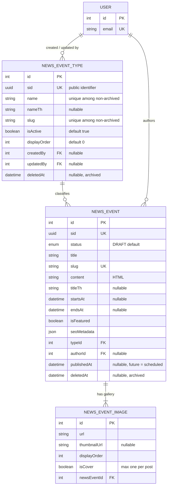

# News & Event Module

Storefront "News & Events" pages and the admin **News & Events** screen. A post can be a news item, an event, a press release, or anything else, because the list of types is managed from the admin panel (`NewsEventType`) rather than hard-coded in an enum. Each post owns its slug, bilingual (EN + TH) content, optional event details (dates and location), SEO metadata, and a gallery of 1–10 images, one of which is the cover.

Schema source: `prisma/schema/news-event.prisma` (models `NewsEventType`, `NewsEvent`, `NewsEventImage`; enum `NewsEventStatus`).
Module source: `src/modules/news-event/`:
- Types: `news-event-type.controller.ts`, `news-event-type.service.ts`, `news-event-type.repository.ts`.
- Posts: `news-event.controller.ts`, `news-event.service.ts`, `news-event.repository.ts`.
- Shared: `news-event.constants.ts` and `dto/`.

Seed script: `prisma/seed-news-event.ts`. See [db-seed.md](./db-seed.md#news--events-seeding).

> **Scope note:** `User` is documented in [user.md](./user.md). It appears here only as the target of the `author` foreign key and of the type audit columns (`createdBy`, `updatedBy`).

---

### DB Schema

#### Entity-Relationship Diagram (ERD)



**Cardinality legend:**
- `||--o{` means one-to-many: the parent must exist and the child count is 0..N.
- `||--|{` means one-to-at-least-one. A post must always keep at least one image; the service enforces this, not the DB.

Every post belongs to exactly one type. A type can have zero or many posts.

---

#### Enum Definitions

##### `NewsEventStatus` (defined in `news-event.prisma`, used only by `NewsEvent`)

| Value      | Meaning                                                                                                                                                       |
| :--------- | :------------------------------------------------------------------------------------------------------------------------------------------------------------ |
| `ACTIVE`   | Published. Shown on the storefront once `publishedAt` is reached, provided its type is active. See [Storefront Visibility](#storefront-visibility).                |
| `INACTIVE` | Taken down by an admin but kept and editable. Never shown publicly.                                                                                           |
| `DRAFT`    | Being written; never shown publicly. **Default value on creation.**                                                                                           |
| `ARCHIVED` | Soft-deleted. Set **only** by the soft-delete endpoint, together with `deletedAt`. **One-way:** an archived post can't be restored or edited. |

> The create/update DTOs accept only `ACTIVE`, `INACTIVE` and `DRAFT` (`EDITABLE_NEWS_EVENT_STATUSES`, enforced with `@IsIn`). `ARCHIVED` can't be set through the form. It always comes paired with `deletedAt`, so the two never disagree.

> Types have no status enum. A type is **active**, **inactive** (`isActive = false`), or **archived** (`deletedAt` set, which also forces `isActive = false`).

---

#### Data Dictionary — NewsEventType

**Table purpose:** an admin-managed category for posts, e.g. News, Event, Press Release. Admins can add or rename types without a migration. Maps to table `news_event_types`.

| Field          | Type             | Constraints                                                                    | Description                                                                                                                         |
| :------------- | :--------------- | :----------------------------------------------------------------------------- | :---------------------------------------------------------------------------------------------------------------------------------- |
| `id`           | `INT`            | PK, AUTOINCREMENT                                                              | Internal key. The admin post form submits it as `typeId`.                                                                           |
| `sid`          | `UUID`           | UNIQUE, NOT NULL, DEFAULT `uuid()`                                             | Public identifier, returned on public routes in place of `id`.                                                                      |
| `name`         | `VARCHAR(100)`   | NOT NULL, **partial unique** (case-insensitive) `WHERE deleted_at IS NULL`      | English name. Two live types can't share a name; an archived type frees its name for reuse.                                         |
| `nameTh`       | `VARCHAR(100)`   | NULLABLE, `@map("name_th")`                                                    | Thai name. The storefront falls back to `name` when it's empty.                                                                     |
| `slug`         | `VARCHAR(120)`   | NOT NULL, **partial unique** `WHERE deleted_at IS NULL`, plain index            | Storefront filter key (`/news-events?type=event`). Derived from `name` by `generateSlug()` and never set by the client.             |
| `isActive`     | `BOOLEAN`        | NOT NULL, DEFAULT `true`, `@map("is_active")`                                  | `false` removes the type from the storefront filter **and hides every one of its posts** from the storefront.                      |
| `displayOrder` | `INT`            | NOT NULL, DEFAULT `0`, `@map("display_order")`                                 | Position in the filter list and dropdowns; lower values come first.                                                                 |
| `createdAt`    | `TIMESTAMPTZ(3)` | NOT NULL, DEFAULT `now()`                                                      | Row creation time.                                                                                                                  |
| `updatedAt`    | `TIMESTAMPTZ(3)` | NOT NULL, `@updatedAt`                                                         | Last modification time.                                                                                                             |
| `createdBy`    | `INT`            | FK → `users.id`, NULLABLE, **ON DELETE SET NULL**, `@map("created_by")`         | Admin who created the type.                                                                                                         |
| `updatedBy`    | `INT`            | FK → `users.id`, NULLABLE, **ON DELETE SET NULL**, `@map("updated_by")`         | Admin who last edited or archived the type.                                                                                         |
| `deletedAt`    | `TIMESTAMPTZ(3)` | NULLABLE, `@map("deleted_at")`                                                 | Archive (soft delete) timestamp. **One-way:** an archived type is read-only and can't be restored.                                  |

---

#### Data Dictionary — NewsEvent

**Table purpose:** a single post. Maps to table `news_events`.

| Field         | Type                    | Constraints                                                              | Description                                                                                                                                  |
| :------------ | :---------------------- | :----------------------------------------------------------------------- | :------------------------------------------------------------------------------------------------------------------------------------------- |
| `id`          | `INT`                   | PK, AUTOINCREMENT                                                        | Internal key, used only on admin routes.                                                                                                     |
| `sid`         | `UUID`                  | UNIQUE, NOT NULL, DEFAULT `uuid()`                                       | Public identifier.                                                                                                                           |
| `status`      | `ENUM(NewsEventStatus)` | NOT NULL, DEFAULT `DRAFT`                                                | Lifecycle state. See the enum above.                                                                                                         |
| `title`       | `VARCHAR(255)`          | NOT NULL                                                                 | English title, and the source of the slug. Two posts may share a title, because the slug gets a numeric suffix.                              |
| `slug`        | `VARCHAR(255)`          | UNIQUE, NOT NULL                                                         | Detail-page URL key. Unique **across archived rows too**, so an archived post's URL is never handed to another post. Frozen once the post has been published. |
| `excerpt`     | `VARCHAR(500)`          | NULLABLE                                                                 | Short summary for cards; also the default meta description.                                                                                  |
| `content`     | `TEXT`                  | NOT NULL                                                                 | Rich-text HTML from the admin editor.                                                                                                        |
| `titleTh`, `excerptTh`, `contentTh` | `VARCHAR(255)` / `VARCHAR(500)` / `TEXT` | NULLABLE, `@map("*_th")`                     | Thai versions of the three fields above. When one is `null`, the storefront falls back to the English text.                                 |
| `startsAt`    | `TIMESTAMPTZ(3)`        | NULLABLE, `@map("starts_at")`                                            | Event start. Drives the `timing=upcoming\|past` public filter.                                                                               |
| `endsAt`      | `TIMESTAMPTZ(3)`        | NULLABLE, `@map("ends_at")`                                              | Event end; the service rejects a value earlier than `startsAt`.                                                                              |
| `location`, `locationTh` | `VARCHAR(255)` | NULLABLE                                                                 | Event venue (EN / TH).                                                                                                                       |
| `isFeatured`  | `BOOLEAN`               | NOT NULL, DEFAULT `false`, `@map("is_featured")`                          | Pins the post to the featured section.                                                                                                       |
| `seoMetadata` | `JSONB`                 | NULLABLE, DEFAULT `{}`, `@map("seo_metadata")`                            | `{ metaTitle, metaDescription, metaTitleTh, metaDescriptionTh }`, the same shape as `Product.seoMetadata`.                                   |
| `typeId`      | `INT`                   | FK → `news_event_types.id`, NOT NULL, **ON DELETE RESTRICT**, `@map("type_id")` | The post's type.                                                                                                                       |
| `authorId`    | `INT`                   | FK → `users.id`, NULLABLE, **ON DELETE SET NULL**, `@map("author_id")`    | The admin who created the post. Exposed publicly only as `authorName`.                                                                       |
| `publishedAt` | `TIMESTAMPTZ(3)`        | NULLABLE, `@map("published_at")`                                         | Date shown on cards. **A future value schedules the post.** Stamped to `now` the first time the post becomes `ACTIVE`, if no value was sent. |
| `createdAt`   | `TIMESTAMPTZ(3)`        | NOT NULL, DEFAULT `now()`                                                | Row creation time; the default admin sort field.                                                                                             |
| `updatedAt`   | `TIMESTAMPTZ(3)`        | NOT NULL, `@updatedAt`                                                   | Last modification time.                                                                                                                      |
| `deletedAt`   | `TIMESTAMPTZ(3)`        | NULLABLE, `@map("deleted_at")`                                           | Soft-delete timestamp, always paired with `status = ARCHIVED`.                                                                               |

---

#### Data Dictionary — NewsEventImage

**Table purpose:** one image in a post's gallery. Maps to table `news_event_images`.

| Field          | Type             | Constraints                                                               | Description                                                                                          |
| :------------- | :--------------- | :------------------------------------------------------------------------ | :--------------------------------------------------------------------------------------------------- |
| `id`           | `INT`            | PK, AUTOINCREMENT                                                         | Referenced by `deleteImageIds` and `coverImage` on update.                                            |
| `url`          | `VARCHAR(512)`   | NOT NULL                                                                  | **Relative** storage path (`/uploads/news-events/images/…`), made absolute by `toAbsoluteUrl()` in the DTOs. |
| `thumbnailUrl` | `VARCHAR(512)`   | NULLABLE, `@map("thumbnail_url")`                                         | Resized variant for cards. Nothing generates it yet; see [Known Gaps](#known-gaps--recommended-hardening). |
| `altText`      | `VARCHAR(255)`   | NULLABLE, `@map("alt_text")`                                              | Set to the post title on upload.                                                                     |
| `displayOrder` | `INT`            | NOT NULL, DEFAULT `0`, `@map("display_order")`                            | Gallery order. New uploads are appended after the current highest value.                            |
| `isCover`      | `BOOLEAN`        | NOT NULL, DEFAULT `false`, `@map("is_cover")`, **max one `true` per post** | The image shown on cards and in the detail-page hero.                                                |
| `newsEventId`  | `INT`            | FK → `news_events.id`, NOT NULL, **ON DELETE CASCADE**                    | Owning post.                                                                                         |
| `createdAt`    | `TIMESTAMPTZ(3)` | NOT NULL, DEFAULT `now()`                                                 | Upload time.                                                                                         |

---

#### Relationships and Cascading Rules

| Parent → Child                                  | FK Column                    | On Delete    | Effect                                                                                       |
| :---------------------------------------------- | :--------------------------- | :----------- | :------------------------------------------------------------------------------------------- |
| `NewsEventType` → `NewsEvent`                   | `NewsEvent.typeId`           | **RESTRICT** | A type with posts can't be hard-deleted. In practice types are never hard-deleted; they are archived. |
| `NewsEvent` → `NewsEventImage`                  | `NewsEventImage.newsEventId` | **CASCADE**  | Hard-deleting a post removes its image rows. Posts are only ever soft-deleted, so this applies only to manual cleanup. |
| `User` → `NewsEvent` (`author`)                 | `NewsEvent.authorId`         | **SET NULL** | Deleting a user keeps their posts; `authorName` becomes absent.                              |
| `User` → `NewsEventType` (`createdByUser`, `updatedByUser`) | `createdBy`, `updatedBy` | **SET NULL** | Deleting a user keeps the type; the audit link becomes `null`.                               |

**Practical implications:**

- **Nothing in this module is ever hard-deleted through the API.** Posts and types are both soft-deleted (archived), and both archives are permanent.
- Archiving a post keeps its row, its image rows and the image files, for the record and for the audit trail.
- Every consumer must handle `author: null` (admin) or a missing `authorName` (public).

---

#### Performance Optimizations (Indexes)

##### Current indexes

| Index                                                         | Table               | Type                     | Purpose                                                                                       |
| :------------------------------------------------------------ | :------------------ | :----------------------- | :-------------------------------------------------------------------------------------------- |
| `sid` (`@unique`)                                             | all three           | B-Tree (unique)          | Public identity lookups.                                                                      |
| `news_event_types_name_active_key` `(LOWER(name)) WHERE deleted_at IS NULL` | `news_event_types` | B-Tree (partial unique) | Name uniqueness among live types, case-insensitive. **Raw SQL** in migration `20261110140000`. |
| `news_event_types_slug_active_key` `(slug) WHERE deleted_at IS NULL` | `news_event_types` | B-Tree (partial unique) | Slug uniqueness among live types. Raw SQL.                                                    |
| `@@index([slug])`                                             | `news_event_types`  | B-Tree                   | The public `?type=<slug>` filter; also declared so Prisma knows the column is indexed.        |
| `@@index([isActive, displayOrder])`                           | `news_event_types`  | B-Tree (composite)       | The active-types list and dropdown, ordered.                                                  |
| `slug` (`@unique`)                                            | `news_events`       | B-Tree (unique)          | Detail-page lookup.                                                                           |
| `@@index([status, publishedAt DESC])`                         | `news_events`       | B-Tree (composite)       | Storefront listing, newest first.                                                             |
| `@@index([typeId, status, publishedAt DESC])`                 | `news_events`       | B-Tree (composite)       | Listing filtered by type, and the same-type half of "You May Also Like".                      |
| `@@index([status, title])`                                    | `news_events`       | B-Tree (composite)       | The storefront "Sort by A to Z" option.                                                       |
| `@@index([status, isFeatured])`                               | `news_events`       | B-Tree (composite)       | The featured section.                                                                         |
| `news_events_title_trgm_idx`                                  | `news_events`       | GIN (`gin_trgm_ops`)     | Admin and public `search` (`ILIKE '%…%'` on `title`). `pg_trgm` is already enabled.           |
| `@@index([newsEventId, isCover])`                             | `news_event_images` | B-Tree (composite)       | Loading a post's gallery and its cover.                                                       |
| `news_event_images_one_cover_per_post` `(news_event_id) WHERE is_cover` | `news_event_images` | B-Tree (partial unique) | **DB-level guarantee of at most one cover per post.** Raw SQL in migration `20261110120000`. |

> **Raw-SQL indexes and `prisma migrate diff`:** Prisma can't express partial indexes, so the three partial unique indexes above exist only in migration SQL. A future `migrate dev` or `migrate diff` may propose dropping them. **Remove those `DROP INDEX` lines** from any generated migration.

##### Recommended future indexes (not yet implemented)

- **A trigram index on `title_th`.** `search` also matches `titleTh`, which today has no index.
- **A partial index `WHERE deleted_at IS NULL`** on the storefront composites, once archived posts are a large share of the table.

---

#### Conventions

- **All `DateTime` columns are `@db.Timestamptz(3)`.** This matches the rest of the schema.
- **Full `@map()` coverage.** Every multi-word column is snake_case in Postgres.
- **Derived values are never client input.** `slug` is derived from `title` (post) or `name` (type), and `authorId`, `createdBy` and `updatedBy` come from the JWT. `ARCHIVED` and `deletedAt` are set only by the soft-delete endpoints.
- **`publishedAt` is the only client-settable timestamp.** It is the scheduling field; leave it empty to publish "now".
- **Bilingual fields:** Thai columns end in `Th` and are nullable. The public DTOs return both languages, and the client picks one by locale with an English fallback.
- **Clearing a field:** an empty string (`""`) sent for a nullable field becomes `null` (`trimToNull`, `toDateOrNull`), so on update `""` clears the column. On a non-nullable field, an absent value or `null` means "leave unchanged".
- **`sid` is the public identifier and `id` is internal.** Public responses never contain `id`, `typeId`, `status`, timestamps other than `publishedAt`, or the author's account.
- **Audit:** both `NewsEventType` and `NewsEvent` are in `TRACKED_AUDIT_MODELS`. The AuditLog extension records create and update, and records archiving as `SOFT_DELETE`, because `deletedAt` goes from `null` to a value. See [audit-log.md](./audit-log.md).

---

#### Example Data

**`news_event_types`**

| name          | slug            | isActive | displayOrder | deletedAt              |
| :------------ | :-------------- | :------- | :----------- | :--------------------- |
| **News**      | `news`          | `true`   | `0`          | `null`                 |
| **Event**     | `event`         | `true`   | `1`          | `null`                 |
| **Promotion** | `promotion`     | `false`  | `3`          | `null`                 |
| **Webinar**   | `webinar`       | `false`  | `5`          | `2026-11-10T08:00:00Z` |

> `Promotion` is inactive: its posts are hidden from the storefront but stay editable, and the type can be switched back on. `Webinar` is archived: its row is read-only, it's gone from every dropdown, and a new type named "Webinar" can be created.

**`news_events`**

| title                              | status     | type      | slug                              | publishedAt            | deletedAt              |
| :--------------------------------- | :--------- | :-------- | :-------------------------------- | :--------------------- | :--------------------- |
| **Healthy Living Workshop in Phuket** | `ACTIVE` | Event    | `healthy-living-workshop-phuket`  | `2026-08-10T09:00:00Z` | `null`                 |
| **New Year Wellness Challenge 2027**  | `ACTIVE` | Event    | `new-year-wellness-challenge-2027` | `2026-12-20T09:00:00Z` | `null`                 |
| **A Practical Guide to Vitamin D**    | `DRAFT`  | News     | `vitamin-d-guide-draft`           | `null`                 | `null`                 |
| **Songkran Delivery Schedule**        | `INACTIVE` | News   | `songkran-delivery-schedule`      | `2026-04-05T09:00:00Z` | `null`                 |
| **Summer Flash Sale 2026**            | `ARCHIVED` | Promotion | `summer-flash-sale-2026`        | `2026-05-01T09:00:00Z` | `2026-06-01T10:00:00Z` |

> `New Year Wellness Challenge 2027` is `ACTIVE` but **scheduled**: its `publishedAt` is in the future, so it appears on the storefront on Dec 20 without any cron job. The admin table shows it as "(scheduled)".

---

#### Example Usage (JSON Response)

**Public listing card** (`NewsEventCardDto`, from `active-news-events` and `related-news-events`):

```json
{
  "sid": "8b4f2c1e-3d5a-4e6f-9a7b-1c2d3e4f5a6b",
  "slug": "healthy-living-workshop-phuket",
  "title": "Healthy Living Workshop in Phuket",
  "titleTh": "เวิร์กช็อปสุขภาพดีที่ภูเก็ต",
  "excerpt": "A free half-day workshop on nutrition and sleep.",
  "startsAt": "2026-09-05T02:00:00.000Z",
  "endsAt": "2026-09-05T06:00:00.000Z",
  "isFeatured": true,
  "publishedAt": "2026-08-10T09:00:00.000Z",
  "type": { "sid": "…", "name": "Event", "nameTh": "กิจกรรม", "slug": "event" },
  "coverImage": {
    "url": "https://api.example.com/uploads/news-events/images/workshop.webp",
    "altText": "Healthy Living Workshop in Phuket",
    "isCover": true
  }
}
```

**Public detail** (`NewsEventPublicDto`) is the card plus `content`, `contentTh`, `location`, `locationTh`, `seoMetadata`, the full `images[]` (cover first) and `authorName`.

**Admin row** (`NewsEventResponseDto`, from `all-news-events` and `news-event-by-id`), abridged:

```json
{
  "id": 14,
  "sid": "…",
  "status": "ARCHIVED",
  "title": "Summer Flash Sale 2026",
  "slug": "summer-flash-sale-2026",
  "isFeatured": false,
  "type": {
    "id": 4,
    "name": "Promotion",
    "slug": "promotion",
    "isActive": false,
    "isArchived": false
  },
  "coverImage": { "id": 31, "url": "https://…/seed-flash-sale.webp", "isCover": true, "displayOrder": 0 },
  "images": [ { "id": 31, "…": "…" } ],
  "author": { "id": 1, "email": "admin@thaihealth.example", "role": "ADMIN", "profile": { "firstName": "Admin", "lastName": "User" } },
  "isLive": false,
  "publishedAt": "2026-05-01T09:00:00.000Z",
  "createdAt": "2026-04-20T08:00:00.000Z",
  "updatedAt": "2026-06-01T10:00:00.000Z",
  "deletedAt": "2026-06-01T10:00:00.000Z"
}
```

> `isLive` is computed in the DTO and never stored. It is `true` only when the post is `ACTIVE`, is not archived, has `publishedAt <= now`, and its type is active, which is the same rule the storefront queries use.

**Admin type row** (`NewsEventTypeResponseDto`): `id`, `sid`, `name`, `nameTh`, `slug`, `isActive`, `displayOrder`, `newsEventCount` (non-archived posts), `deletedAt`, `createdAt`, `updatedAt`, `createdByUser`, `updatedByUser`.

---

#### Implementation & Best Practices

##### Storefront Visibility

A post is visible on the storefront only when **all four** of these conditions hold. They are defined once, in `NewsEventRepository.publicVisibilityWhere()`, and applied to the list, detail and related queries:

```ts
{
  status: NewsEventStatus.ACTIVE,
  deletedAt: null,
  publishedAt: { lte: now },   // future = scheduled
  type: { isActive: true },    // an inactive or archived type hides all its posts
}
```

- **Scheduling needs no cron job.** A post with a future `publishedAt` starts matching the query when that time arrives.
- **Hidden posts return `404` on the public detail and related routes.** They are never served with a "not published" flag.
- **Deactivating a type** hides its posts without touching them. Reactivating it brings them back.

##### Archive Rules (One-Way)

| Entity | Archive allowed when                                              | What happens                                                                                     | After archiving                                                                                                                            |
| :----- | :---------------------------------------------------------------- | :----------------------------------------------------------------------------------------------- | :----------------------------------------------------------------------------------------------------------------------------------------- |
| Post   | It isn't already archived.                                         | `status = ARCHIVED`, `deletedAt = now`. Images and files are kept.                               | **Read-only:** update → `409`, soft delete → `409`. Stays in the admin list; View works, Edit and Delete are shown but disabled.                       |
| Type   | **No post of the type is `ACTIVE`**; inactive, draft and archived posts don't block it. | `deletedAt = now`, `isActive = false`, `updatedBy` = the acting admin.                           | **Read-only:** update → `409`, archive → `409`. Removed from the storefront filter and the post-form dropdown. Its name and slug become free to reuse. |

**Posts left on an archived type** stay in the admin table, tagged "TYPE ARCHIVED", and can still be edited. They can't be set to `ACTIVE` until they are moved to an active type (`400`), so an archived type never holds a live post.

There is **no restore endpoint** for either entity, by design.

##### Images & Cover

- **Create** needs 1–10 images. The **first** uploaded file becomes the cover (`isCover = true`, `displayOrder = 0`).
- **Update** never replaces the gallery wholesale:
  - `images` → new files are **appended**.
  - `deleteImageIds` → removes the listed existing images.
  - `coverImage` → picks the cover: an existing image id (`"12"`), or `"new:<n>"` for the n-th file uploaded in the same request (0-based).
  - If the current cover is deleted and no `coverImage` is sent, the first remaining image is promoted.
- **Everything is validated before storage is touched:** unknown ids, the 1..10 total and the cover reference.
- **Files are written before the DB transaction runs**, and deleted again if it fails. **Files of removed images are deleted only after the transaction commits**, so a failed update never loses an image.
- The upload filter (`NEWS_EVENT_IMAGE_UPLOAD_OPTIONS`) allows JPEG, PNG, WEBP, GIF and AVIF, at most 5 MB per file and 10 files. Multer rejects anything else before the service runs.
- The `one_cover_per_post` partial unique index is the DB backstop: `setCoverImage` clears the old cover and sets the new one in the same transaction.

##### Slugs

- **Post slugs** come from `generateSlug(title)`, truncated to 240 characters to leave room for a suffix. A clash gets a numeric suffix (`-2`, `-3`…) instead of a `409`, so two events may share a title. Slugs stay unique across archived posts too, so an old URL never points at a different post.
- **A post's slug is frozen once it has been published** (`publishedAt` set). Changing the title of a published post leaves its URL unchanged, so shared links and search results keep working.
- **Type slugs** come from `name`, and a clash returns `409`. A name with no English letters or digits (Thai only) is rejected with `400`, because the slug would be empty.

##### `publishedAt` Resolution (`resolvePublishedAt`)

1. An explicit value always wins, including a future (scheduled) date.
2. Otherwise, the first time a post becomes `ACTIVE` with no date set, it is stamped with `now`.
3. An existing date is never overwritten implicitly; re-saving an active post keeps it.
4. Sending `""` (that is, `null`) clears the date, but only on a post that isn't `ACTIVE`.

---

#### Known Gaps / Recommended Hardening

- **`content` and `contentTh` HTML is not sanitized on the server.** The admin editor produces HTML that the storefront renders as-is. Add a server-side sanitizer such as `sanitize-html` with an allow-list before this content can come from any less-trusted role.
- **Nothing generates `thumbnailUrl`.** Cards fall back to the full-size `url`. A resize step on upload (for example `sharp`) would cut payloads on the listing page.
- **No index on `titleTh`.** See the recommended indexes above.
- **Raw-SQL indexes can drift.** See the note under the indexes table; review generated migrations for `DROP INDEX` on the three partial indexes.
- **`DELETE` is admin-only, but `MARKETING` can set a post `INACTIVE`.** This is intentional (a reversible take-down versus a permanent archive), but worth knowing when assigning roles.

---

### API End Point & Business Logic

Two controllers share this module:
- `NewsEventTypeController` → `NewsEventTypeService` → `NewsEventTypeRepository`, prefixed `/api/v1/news-event-type`.
- `NewsEventController` → `NewsEventService` → `NewsEventRepository`, prefixed `/api/v1/news-event`.

`NewsEventService` depends on `NewsEventTypeService` (`assertTypeAssignable`) and never reads the type table directly.

#### Endpoint Overview

**Types — `/api/v1/news-event-type`**

| Method   | Path                                   | Access               | Purpose                                                           |
| :------- | :------------------------------------- | :------------------- | :---------------------------------------------------------------- |
| `POST`   | `/create-news-event-type`              | `ADMIN`, `MARKETING` | [Create a type](#create-a-type)                                   |
| `GET`    | `/all-news-event-types`                | `ADMIN`, `MARKETING` | [Admin listing, all states](#list-all-types-admin)                |
| `GET`    | `/active-news-event-type-options`      | `ADMIN`, `MARKETING` | [Post-form dropdown](#active-type-options-admin)                  |
| `GET`    | `/news-event-type-by-id/:id`           | `ADMIN`, `MARKETING` | Single type, admin shape (`404` if missing)                       |
| `PATCH`  | `/update-news-event-type/:id`          | `ADMIN`, `MARKETING` | [Partial update](#update-a-type)                                  |
| `DELETE` | `/soft-delete-news-event-type/:id`     | `ADMIN` only         | [Archive (one-way)](#archive-a-type)                              |
| `GET`    | `/active-news-event-types`             | **Public**           | [Storefront filter list](#active-types-public)                    |

**Posts — `/api/v1/news-event`**

| Method   | Path                              | Access               | Purpose                                                    |
| :------- | :-------------------------------- | :------------------- | :--------------------------------------------------------- |
| `POST`   | `/create-news-event`              | `ADMIN`, `MARKETING` | [Create a post](#create-a-post)                            |
| `GET`    | `/all-news-events`                | `ADMIN`, `MARKETING` | [Admin listing, archived included](#list-all-posts-admin)  |
| `GET`    | `/news-event-by-id/:id`           | `ADMIN`, `MARKETING` | Single post, admin shape, archived included (`404` if missing) |
| `PATCH`  | `/update-news-event/:id`          | `ADMIN`, `MARKETING` | [Partial update](#update-a-post)                           |
| `DELETE` | `/soft-delete-news-event/:id`     | `ADMIN` only         | [Archive (one-way)](#archive-a-post)                       |
| `GET`    | `/active-news-events`             | **Public**           | [Storefront listing](#list-posts-public)                   |
| `GET`    | `/news-event-by-slug/:slug`       | **Public**           | [Detail page](#get-post-by-slug-public)                    |
| `GET`    | `/related-news-events/:slug`      | **Public**           | ["You May Also Like"](#related-posts-public)               |

Guarded routes use `JwtAuthGuard` + `RolesGuard` + `@Roles(...)`. Both `DELETE` routes are **stricter** than the rest: `MARKETING` can create, edit and unpublish, but only `ADMIN` can archive.

> Guard rejections (`401` / `403`) happen before the HTTP logging interceptor runs, so they **don't appear in the request log**. When a call "does nothing", check the browser's Network tab.

---

#### Response Shapes & Select Projections

| Select / DTO                                          | Used by                                   | Contains                                                                                                                         |
| :---------------------------------------------------- | :---------------------------------------- | :------------------------------------------------------------------------------------------------------------------------------- |
| `NEWS_EVENT_SELECT_ADMIN` → `NewsEventResponseDto`     | admin post routes                         | Every column, type `{ id, name, nameTh, slug, isActive, isArchived }`, full author account, full gallery (cover first), computed `isLive`. |
| `NEWS_EVENT_SELECT_CARD` → `NewsEventCardDto`          | public list, related                      | No body, cover image only, public type `{ sid, name, nameTh, slug }`. `id` and `typeId` are selected for the related lookup but **never copied into the DTO**. |
| `NEWS_EVENT_SELECT_PUBLIC_DETAIL` → `NewsEventPublicDto` | public detail                           | The card fields plus body, location, SEO, full gallery, and `authorName` (first and last name only).                             |
| `TYPE_SELECT_ADMIN` → `NewsEventTypeResponseDto`       | admin type routes                         | Every column, `newsEventCount` (non-archived posts), and the audit users.                                                       |
| `TYPE_SELECT_PUBLIC` → `NewsEventTypePublicDto`        | public filter                             | `{ sid, name, nameTh, slug }`.                                                                                                   |
| → `NewsEventTypeOptionDto`                             | post-form dropdown                        | `{ id, name, nameTh }`.                                                                                                          |

**Image URLs** are stored relative and made absolute with the shared `toAbsoluteUrl(path, baseUrl)`. A value that already starts with `http` is left untouched.

---

#### Create a Type

**`POST /api/v1/news-event-type/create-news-event-type`**

**Purpose**: Add a new type.

**Access**: `ADMIN`, `MARKETING`. Accepts `multipart/form-data` or JSON (`AnyFilesInterceptor`, used only so Swagger renders one input per field).

| Layer      | What happens                                                                                      |
| :--------- | :------------------------------------------------------------------------------------------------ |
| Controller | `createType(dto, req)`: reads `req.user.id` (`401` if missing).                                  |
| Service    | `createType(userId, dto)`: derives the slug, checks for a clash, creates the row with `createdBy` and `updatedBy` set to the acting user. |
| Repository | `findConflicting(name, slug)` → `createType(data)`.                                               |

**Business logic:**

1. **Slug** = `generateSlug(name)`. An empty result (no English letters or digits) → `400`.
2. **Clash check** among non-archived types: same name (case-insensitive) or same slug → `409`. An archived type with the same name doesn't count.
3. **Insert.** `isActive` defaults to `true` and `displayOrder` to `0`.

| Status | Cause                                                                    |
| :----- | :----------------------------------------------------------------------- |
| `201`  | Created; returns `NewsEventTypeResponseDto`.                              |
| `400`  | Validation: `name` empty or over 100 chars, `nameTh` over 100, `displayOrder` negative, or a name without English letters. |
| `401` / `403` | Not logged in / not `ADMIN` or `MARKETING`.                        |
| `409`  | A live type with this name or slug already exists.                       |

---

#### List All Types (Admin)

**`GET /api/v1/news-event-type/all-news-event-types`**

Paginated (`PaginationQueryDto`) plus an optional `isActive` filter. `search` matches `name` and `nameTh`, and the default sort is `displayOrder`.

Returns **every type, including archived ones** (archived types have `deletedAt` set and `isActive: false`). `newsEventCount` counts only non-archived posts. Response: `{ data: NewsEventTypeResponseDto[], meta }`.

---

#### Active Type Options (Admin)

**`GET /api/v1/news-event-type/active-news-event-type-options`**

Backs the **Type** dropdown in the add/edit post modal. Returns every type that is `isActive = true` **and** not archived, as `{ id, name, nameTh }`, ordered by `displayOrder` then `name`. Not paginated, because the list is small and the dropdown needs all of it.

> The client adds the post's *current* type back into the edit dropdown when that type is inactive or archived, labelled "(inactive)" or "(archived)", so the field doesn't look empty. The server still allows keeping that type; it refuses only a *switch* to a non-assignable type.

---

#### Update a Type

**`PATCH /api/v1/news-event-type/update-news-event-type/:id`**

**Access**: `ADMIN`, `MARKETING`.

**Business logic:**

1. **Existence** → `404`. **Archived** → `409 "Archived types cannot be edited"`.
2. **Rename** (only when `name` actually changes): the slug is re-derived and clash-checked against *other* live types → `409`.
3. **Write.** On non-nullable columns (`name`, `isActive`, `displayOrder`), a `null` means "not provided". `nameTh: ""` clears the Thai name. `updatedBy` is set to the acting user.

> Setting `isActive: false` here is the **reversible** way to hide a type and all its posts. Archiving is the permanent way.

| Status | Cause                                                       |
| :----- | :---------------------------------------------------------- |
| `200`  | Updated; returns `NewsEventTypeResponseDto`.                 |
| `400`  | Validation failed.                                          |
| `404`  | Type doesn't exist.                                         |
| `409`  | Type is archived, or the new name clashes with a live type. |

---

#### Archive a Type

**`DELETE /api/v1/news-event-type/soft-delete-news-event-type/:id`**

**Purpose**: Permanently retire a type. This is a soft delete with no restore.

**Access**: `ADMIN` only.

| Layer      | What happens                                                                                           |
| :--------- | :----------------------------------------------------------------------------------------------------- |
| Controller | `archiveType(id, req)`: `ParseIntPipe`, reads `req.user.id`.                                          |
| Service    | `archiveType(id, userId)`: existence check, already-archived check, active-post check, then archive.  |
| Repository | `findIdById(id)` → `countActiveNewsEvents(id)` → `archiveType(id, userId)`.                            |

**Business logic — in order:**

1. **Existence** → `404`.
2. **Already archived** → `409 "This type is already archived"`.
3. **Active-post check.** Counts posts of this type with `status = ACTIVE` and `deletedAt IS NULL`. **Any → `409`**, and the message gives the count and tells the admin to set those posts to Inactive or Draft, or move them to another type. Inactive, draft and archived posts **don't** block archiving.
4. **Archive.** `deletedAt = now`, `isActive = false`, `updatedBy = userId`. Because `isActive` is forced off, every existing `isActive` filter (storefront, visibility, dropdown) excludes the type with no further changes. The AuditLog extension records the change as `SOFT_DELETE`.

| Status | Cause                                                          |
| :----- | :------------------------------------------------------------- |
| `204`  | Archived (no body).                                            |
| `401` / `403` | Not logged in / not `ADMIN`.                            |
| `404`  | Type doesn't exist.                                            |
| `409`  | Type has active posts, or is already archived.                 |

---

#### Active Types (Public)

**`GET /api/v1/news-event-type/active-news-event-types`**

The storefront filter tabs. Returns live, active types as `NewsEventTypePublicDto[]` (`sid`, `name`, `nameTh`, `slug`), ordered by `displayOrder` then `name`. Use `slug` as the `type` query parameter on `active-news-events`.

---

#### Create a Post

**`POST /api/v1/news-event/create-news-event`**

**Access**: `ADMIN`, `MARKETING`. `multipart/form-data` with images in the `images` field (`FilesInterceptor`, max 10). Send `seoMetadata` as a JSON-encoded string.

| Layer      | What happens                                                                                                                         |
| :--------- | :----------------------------------------------------------------------------------------------------------------------------------- |
| Controller | `createNewsEvent(dto, files, req)`: reads `req.user.id` as the author.                                                              |
| Service    | `createNewsEvent(userId, dto, images)`: image count, type check, event-window check, `publishedAt`, unique slug, upload, insert, rollback. |
| Repository | `slugExists(slug)` (loop) → `createNewsEvent(data)`: one `create` with nested `images.create`.                                       |

**Business logic — in order:**

1. **At least one image** → otherwise `400`. Multer files bypass class-validator, so the service checks this.
2. **Type is assignable** (`assertTypeAssignable`): it must exist, not be archived, and be active → otherwise `400`.
3. **Event window:** `endsAt < startsAt` → `400`.
4. **`status`** defaults to `DRAFT`; **`publishedAt`** is resolved (see [`publishedAt` Resolution](#publishedat-resolution-resolvepublishedat)).
5. **Unique slug** from the title, with a numeric suffix on a clash.
6. **Upload files**, then **one insert**: the post plus its image rows, where image 0 is the cover and `altText` is the title. If the insert fails, the uploaded files are deleted before the error propagates.

| Status | Cause                                                                                                              |
| :----- | :----------------------------------------------------------------------------------------------------------------- |
| `201`  | Created; returns `NewsEventResponseDto`.                                                                            |
| `400`  | DTO validation, no images, wrong file type or size, type missing, inactive or archived, `endsAt` before `startsAt`, or status `ARCHIVED`. |
| `401` / `403` | Not logged in / not `ADMIN` or `MARKETING`.                                                                  |

---

#### List All Posts (Admin)

**`GET /api/v1/news-event/all-news-events`**

Paginated, with optional filters `status`, `typeId` and `isFeatured`. `sortBy` is one of `createdAt` (default), `updatedAt`, `publishedAt`, `title`; the direction comes from `sortOrder`. `search` matches `title` and `titleTh`.

**There is no `deletedAt` filter.** Archived posts are listed alongside the rest and marked by `status: ARCHIVED`; pass `status=ARCHIVED` to see only those. Response: `{ data: NewsEventResponseDto[], meta }`.

---

#### Update a Post

**`PATCH /api/v1/news-event/update-news-event/:id`**

**Access**: `ADMIN`, `MARKETING`. `multipart/form-data`. Send only the fields that changed.

| Layer      | What happens                                                                                                              |
| :--------- | :------------------------------------------------------------------------------------------------------------------------ |
| Controller | `updateNewsEvent(id, dto, files)`.                                                                                       |
| Service    | `updateNewsEvent(id, dto, newImages)`: guards, image validation, field mapping, slug rule, then one transaction.         |
| Repository | `findByIdAdmin` → (`deleteImages`, `createImages`, `setCoverImage`, `updateNewsEvent`) inside `withTransaction`.          |

**Business logic — in order:**

1. **Existence** → `404`. **Archived** → `409 "Archived posts cannot be edited"`.
2. **Type change:** if `typeId` changes, the new type must be assignable → otherwise `400`.
3. **Archived-type guard:** if the post stays on an **archived** type, it can't become (or remain) `ACTIVE` → `400 "…Move it to an active type before setting it Active."`
4. **Event window** is checked against the merged old and new values → `400`.
5. **Image validation** before any upload:
   - Every `deleteImageIds` entry must belong to this post.
   - The resulting total must be 1–10.
   - `coverImage` must point at a remaining image or at an uploaded file index.
6. **Field mapping:**
   - Non-nullable fields: `null` means "unchanged".
   - Nullable fields: `null` (that is, `""`) clears the column.
   - `seoMetadata` is replaced as a whole object when sent.
   - `publishedAt` is resolved.
7. **Slug:** re-derived from a new title **only while the post has never been published**.
8. **Upload new files**, then **one transaction**: delete the listed images → insert the new ones (appended to the gallery order) → set the cover (explicit choice, or promote the first remaining image if the cover was deleted) → update the post. If the transaction fails, the uploaded files are deleted. **After the commit**, the files of deleted images are removed from storage.

| Status | Cause                                                                                                   |
| :----- | :------------------------------------------------------------------------------------------------------ |
| `200`  | Updated; returns `NewsEventResponseDto`.                                                                 |
| `400`  | Validation, image rule broken, bad `coverImage`, type not assignable, or setting Active on an archived type. |
| `404`  | Post doesn't exist.                                                                                     |
| `409`  | Post is archived (read-only).                                                                           |

---

#### Archive a Post

**`DELETE /api/v1/news-event/soft-delete-news-event/:id`**

**Access**: `ADMIN` only.

1. **Existence** → `404`. **Already archived** → `409 "This post is already deleted"`.
2. **Archive:** `status = ARCHIVED`, `deletedAt = now`. The row, its image rows and the files are **kept**. The post disappears from every public route immediately and stays in the admin list as read-only. The AuditLog extension records the change as `SOFT_DELETE`.

**There is no restore.** To take a post down temporarily, set it to `INACTIVE` instead.

| Status | Cause                               |
| :----- | :---------------------------------- |
| `204`  | Archived (no body).                 |
| `401` / `403` | Not logged in / not `ADMIN`. |
| `404`  | Post doesn't exist.                 |
| `409`  | Already archived.                   |

---

#### List Posts (Public)

**`GET /api/v1/news-event/active-news-events`**

**Access**: Public.

**Query** (`NewsEventPublicQueryDto`, which extends `PaginationQueryDto`):
- `type`: a type slug.
- `isFeatured`.
- `timing`: `upcoming` = `startsAt >= now`; `past` = `startsAt < now`. Posts without `startsAt` are excluded when this is set.
- `sortBy`: `publishedAt` (default) or `title`. "Sort by A to Z" = `sortBy=title&sortOrder=asc`.
- `search`: matches `title` and `titleTh`.

The filters are combined with [storefront visibility](#storefront-visibility) using `AND: [filters, visibility]` rather than an object spread. Both sides can carry a `type` condition (the slug filter and `type.isActive`), and a spread would silently drop one of them.

Response: `{ data: NewsEventCardDto[], meta }`. An empty page returns `200`.

---

#### Get Post by Slug (Public)

**`GET /api/v1/news-event/news-event-by-slug/:slug`**

`findPublicBySlug` applies the full visibility rule. A slug that is a draft, inactive, archived, scheduled, or under an inactive or archived type returns **`404`**, the same as a slug that doesn't exist. Response: `NewsEventPublicDto`.

---

#### Related Posts (Public)

**`GET /api/v1/news-event/related-news-events/:slug?limit=3`**

"You May Also Like" on the detail page. `limit` defaults to 3, maximum 12.

1. Resolve the current post with the same visibility rule (`findPublicIdentityBySlug`) → `404` if it isn't visible.
2. **Same type first:** the latest visible posts of the same type, excluding the current one.
3. **Top up** with the latest visible posts of other types if fewer than `limit` were found.

This takes two small indexed queries instead of one `ORDER BY CASE …` that couldn't use an index. Response: `NewsEventCardDto[]`.

---

#### Built but Not Yet Exposed

- `NewsEventRepository.findImages(newsEventId)` has no caller. The update path reads the gallery from `findByIdAdmin` instead. Either delete it or use it for a future "reorder images" endpoint.

Every other repository method is called by exactly one service method, and every service method is reachable through exactly one route above.
