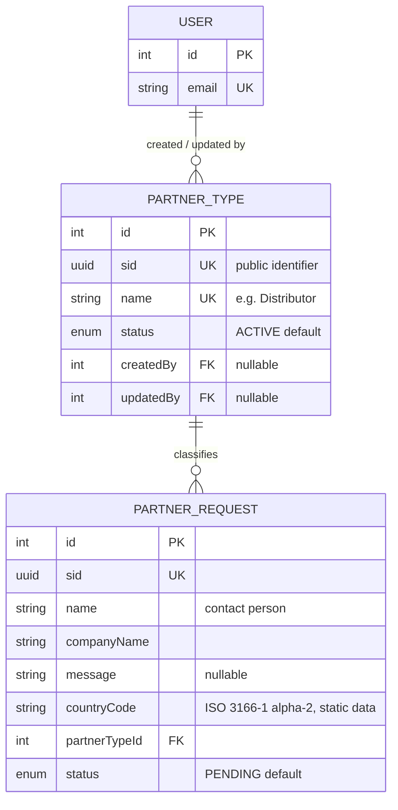

# Partner Module

The storefront **"Become a Partner"** form (the navbar button opens a modal) and the admin **Our Partner** screen. Visitors submit a short enquiry: name, company, partner type, country and an optional message. They don't need an account, so a request has no `User` relation. Admins review the enquiries in the **Message** tab and move each one through a status, and they manage the **Type** dropdown options in the **Type** tab.

The list of partner types is managed from the admin panel (`PartnerType`), not hard-coded. **Countries are static data**: the 249 ISO 3166-1 alpha-2 codes in `src/common/geography/countries.ts`. A request stores only the 2-letter code.

Schema source: `prisma/schema/partner.prisma` (models `PartnerType`, `PartnerRequest`; enums `PartnerOptionStatus`, `PartnerRequestStatus`).
Module source: `src/modules/partner/`:
- One controller, service and repository: `partner.controller.ts`, `partner.service.ts`, `partner.repository.ts`.
- `partner.constants.ts` (submit rate limit) and `dto/` (`partner-option.dto.ts`, `partner-request.dto.ts`, `partner-response.dto.ts`).
- Country data: `src/common/geography/countries.ts` (`COUNTRIES`, `COUNTRY_CODES`, `getCountryName`).

Seed script: `prisma/seed-partner.ts`. See [Seeding](#seeding).

Migrations: `20261111100000_add_partner_module`, `20261111110000_partner_request_archived_status`, `20261112100000_partner_country_static`.

> **Scope note:** `User` is documented in [user.md](./user.md). It appears here only as the target of the type audit columns (`createdBy`, `updatedBy`).

---

### DB Schema

#### Entity-Relationship Diagram (ERD)



**Cardinality legend:**
- `||--o{` means one-to-many: the parent must exist and the child count is 0..N.

Every request belongs to exactly one type. A type can have zero or many requests. **There is no country table.** `countryCode` is a plain column, validated against the static list by the DTO.

---

#### Enum Definitions

##### `PartnerOptionStatus` (used by `PartnerType`)

| Value      | Meaning                                                                                                                         |
| :--------- | :------------------------------------------------------------------------------------------------------------------------------ |
| `ACTIVE`   | Shown in the public form's **Type** dropdown. **Default value on creation.**                                                     |
| `INACTIVE` | Hidden from the public form, still listed and editable in admin. Reversible.                                                    |
| `ARCHIVED` | Soft-deleted. Set **only** by the delete endpoint. **One-way:** an archived type is read-only. Re-adding its name restores it (see [Create a Type](#create-a-type)). |

> The create DTO rejects `ARCHIVED` (`400 "A new entry cannot be created as ARCHIVED"`), and the update endpoint rejects it too (`400`, "use the delete endpoint").

##### `PartnerRequestStatus` (used by `PartnerRequest`)

| Value       | Meaning                                                                                                 |
| :---------- | :------------------------------------------------------------------------------------------------------ |
| `PENDING`   | Just submitted, not yet looked at. **Default value on creation.**                                       |
| `CONTACTED` | An admin has reached out.                                                                               |
| `APPROVED`  | Accepted as a partner.                                                                                  |
| `REJECTED`  | Declined.                                                                                               |
| `ARCHIVED`  | Soft-deleted. Set **only** by the soft-delete endpoint. **One-way:** an archived request is read-only. |

> The admin moves a request freely between the first four values. `ARCHIVED` can't be set through the status endpoint (`400`).

---

#### Data Dictionary — PartnerType

**Table purpose:** an admin-managed option for the form's **Type** dropdown, e.g. Pharmacy, Dealer, Distributor. Admins can add, rename or hide types without a migration. Maps to table `partner_types`.

| Field       | Type                        | Constraints                                                               | Description                                                                                         |
| :---------- | :-------------------------- | :------------------------------------------------------------------------ | :-------------------------------------------------------------------------------------------------- |
| `id`        | `INT`                       | PK, AUTOINCREMENT                                                         | Internal key. The public form submits it as `partnerTypeId`. The public dropdown orders by it.      |
| `sid`       | `UUID`                      | UNIQUE, NOT NULL, DEFAULT `uuid()`                                        | Public identifier (currently returned only on admin routes).                                        |
| `name`      | `VARCHAR(100)`              | UNIQUE, NOT NULL                                                          | Display name. Unique **across archived rows too**. The service also blocks case-insensitive duplicates. |
| `status`    | `ENUM(PartnerOptionStatus)` | NOT NULL, DEFAULT `ACTIVE`                                                | Lifecycle state. See the enum above.                                                                |
| `createdBy` | `INT`                       | FK → `users.id`, NULLABLE, **ON DELETE SET NULL**, `@map("created_by")`    | Admin who created the type.                                                                         |
| `updatedBy` | `INT`                       | FK → `users.id`, NULLABLE, **ON DELETE SET NULL**, `@map("updated_by")`    | Admin who last edited, archived or restored the type.                                               |
| `createdAt` | `TIMESTAMPTZ(3)`            | NOT NULL, DEFAULT `now()`                                                 | Row creation time.                                                                                  |
| `updatedAt` | `TIMESTAMPTZ(3)`            | NOT NULL, `@updatedAt`                                                    | Last modification time.                                                                             |

---

#### Data Dictionary — PartnerRequest

**Table purpose:** one "Become a Partner" submission. Maps to table `partner_requests`.

| Field           | Type                         | Constraints                                                                              | Description                                                                                                  |
| :-------------- | :--------------------------- | :--------------------------------------------------------------------------------------- | :----------------------------------------------------------------------------------------------------------- |
| `id`            | `INT`                        | PK, AUTOINCREMENT                                                                        | Internal key, used on admin routes.                                                                          |
| `sid`           | `UUID`                       | UNIQUE, NOT NULL, DEFAULT `uuid()`                                                       | Public identifier.                                                                                           |
| `name`          | `VARCHAR(150)`               | NOT NULL                                                                                 | Contact person. Trimmed.                                                                                     |
| `companyName`   | `VARCHAR(200)`               | NOT NULL, `@map("company_name")`                                                         | Company name. Trimmed.                                                                                       |
| `message`       | `TEXT`                       | NULLABLE                                                                                 | Optional free text, max 2000 characters (DTO). An empty string is stored as `null`.                          |
| `countryCode`   | `VARCHAR(2)`                 | NOT NULL, `@map("country_code")`                                                         | ISO 3166-1 alpha-2 code, stored upper-case (`TH`). Must be in `COUNTRY_CODES`. **Not a foreign key.**        |
| `partnerTypeId` | `INT`                        | FK → `partner_types.id`, NOT NULL, **ON DELETE RESTRICT**, `@map("partner_type_id")`     | The selected type. Must be `ACTIVE` at submission time.                                                      |
| `status`        | `ENUM(PartnerRequestStatus)` | NOT NULL, DEFAULT `PENDING`                                                              | Admin workflow state. See the enum above.                                                                    |
| `createdAt`     | `TIMESTAMPTZ(3)`             | NOT NULL, DEFAULT `now()`                                                                | Submission time ("Received" in admin).                                                                       |
| `updatedAt`     | `TIMESTAMPTZ(3)`             | NOT NULL, `@updatedAt`                                                                   | Last status change.                                                                                          |

---

#### Static Country Data

Countries used to be an admin-managed table (`partner_countries`). Migration `20261112100000_partner_country_static` replaced that table with static data.

- **Source of truth:** `src/common/geography/countries.ts` holds the 249 ISO 3166-1 alpha-2 codes with English names (`COUNTRIES`), plus `COUNTRY_CODES` (used for validation) and `getCountryName(code)`, which falls back to the raw code.
- **Client copy:** `thai-health-product-client/src/constants/countries.ts` holds the **identical** list. **Change both together.** If the dropdown offers a code the server doesn't know, the submission fails with a `400`.
- **Localisation is client-side.** The English site uses the names from the list. Other locales (Thai) use the browser's `Intl.DisplayNames`, falling back to English. The API always returns the English name.
- **What the migration did:** it added `country_code` and backfilled it by matching each old `partner_countries.name` to a code (case-insensitive, including common aliases such as "USA", "UK" and "Turkey"). It **aborts** if any request can't be mapped. It then dropped the FK, the `partner_country_id` column and the `partner_countries` table.

---

#### Relationships and Cascading Rules

| Parent → Child                                            | FK Column                       | On Delete    | Effect                                                                                     |
| :-------------------------------------------------------- | :------------------------------ | :----------- | :----------------------------------------------------------------------------------------- |
| `PartnerType` → `PartnerRequest`                           | `PartnerRequest.partnerTypeId`  | **RESTRICT** | A type with requests can't be hard-deleted. Types are only ever archived through the API.   |
| `User` → `PartnerType` (`createdByUser`, `updatedByUser`) | `createdBy`, `updatedBy`        | **SET NULL** | Deleting a user keeps the type; the audit link becomes `null`.                             |

**Practical implications:**

- **Types are never hard-deleted through the API.** They are archived, and old requests keep showing their type name.
- **Requests can be hard-deleted.** Nothing references `partner_requests`, so a hard delete removes only that row. The admin UI's Delete button uses the hard delete; the soft-delete (archive) endpoint still exists but is unused.
- **Countries can't dangle.** A request holds a code, not a reference, so changing the static list never breaks old rows; an unknown code is shown as the raw code.

---

#### Performance Optimizations (Indexes)

##### Current indexes

| Index                                  | Table              | Type               | Purpose                                                                              |
| :------------------------------------- | :----------------- | :----------------- | :----------------------------------------------------------------------------------- |
| `sid` (`@unique`)                      | both tables        | B-Tree (unique)    | Public identity lookups.                                                             |
| `name` (`@unique`)                     | `partner_types`    | B-Tree (unique)    | Name uniqueness (case-sensitive at DB level; the service adds a case-insensitive check). |
| `@@index([status])`                    | `partner_types`    | B-Tree             | The public active-types dropdown and the admin `?status=` filter.                    |
| `@@index([status, createdAt])`         | `partner_requests` | B-Tree (composite) | Admin list filtered by status, newest first.                                         |
| `@@index([partnerTypeId])`             | `partner_requests` | B-Tree             | The admin `?partnerTypeId=` filter, and the FK.                                      |
| `@@index([countryCode])`               | `partner_requests` | B-Tree             | The admin `?countryCode=` filter.                                                    |

##### Recommended future indexes (not yet implemented)

- **Trigram indexes on `name` and `company_name`.** The admin `search` uses `ILIKE '%…%'` on both columns, which a B-Tree can't serve. This only matters once the table is large.

---

#### Conventions

- **All `DateTime` columns are `@db.Timestamptz(3)`.** This matches the rest of the schema.
- **Full `@map()` coverage.** Every multi-word column is snake_case in Postgres.
- **Derived values are never client input.** `createdBy` and `updatedBy` come from the JWT. `ARCHIVED` is set only by the delete endpoints.
- **Text input is trimmed** (`@Transform(trim)`), and `countryCode` is also upper-cased, so `th` is accepted and stored as `TH`.
- **No audit-log tracking.** Neither `PartnerType` nor `PartnerRequest` is in `TRACKED_AUDIT_MODELS`. Type changes are attributed only through `createdBy` / `updatedBy`. See [audit-log.md](./audit-log.md).

---

#### Example Data

**`partner_types`**

| id | name                      | status     |
| :- | :------------------------ | :--------- |
| 1  | **Pharmacy**              | `ACTIVE`   |
| 2  | **Dealer**                | `ACTIVE`   |
| 3  | **Distributor**           | `ACTIVE`   |
| 4  | **International Partner** | `INACTIVE` |
| 5  | **Wholesaler**            | `ARCHIVED` |

> `International Partner` is hidden from the public form but stays editable and can be switched back on. `Wholesaler` is archived: read-only and gone from the form, but its old requests still show it. Creating a new type named "Wholesaler" restores this row.

**`partner_requests`**

| name                 | companyName            | type        | countryCode | status      | createdAt              |
| :------------------- | :--------------------- | :---------- | :---------- | :---------- | :--------------------- |
| **Somchai Jaidee**   | Siam Health Co., Ltd.  | Distributor | `TH`        | `PENDING`   | `2026-11-12T07:33:00Z` |
| **Anna Petrova**     | Nordic Wellness LLC    | Distributor | `RU`        | `APPROVED`  | `2026-11-11T06:28:00Z` |
| **Rahim Uddin**      | Dhaka Pharma Traders   | Dealer      | `BD`        | `CONTACTED` | `2026-11-10T09:15:00Z` |
| **John Carter**      | Carter Supplies        | Wholesaler  | `US`        | `ARCHIVED`  | `2026-10-02T03:00:00Z` |

---

#### Example Usage (JSON Response)

**Admin request row** (`PartnerRequestResponseDto`, from `all-requests`, `request/:id`, status update and both deletes):

```json
{
  "id": 1,
  "sid": "550e8400-e29b-41d4-a716-446655440000",
  "name": "Somchai Jaidee",
  "companyName": "Siam Health Co., Ltd.",
  "message": "We would like to distribute your products in Chiang Mai.",
  "status": "PENDING",
  "partnerType": { "id": 3, "name": "Distributor" },
  "country": { "code": "TH", "name": "Thailand" },
  "createdAt": "2026-11-12T07:33:00.000Z",
  "updatedAt": "2026-11-12T07:33:00.000Z"
}
```

> `country.name` is resolved from the code by `getCountryName()` when the DTO is built; it is not stored. `message` is omitted when it is `null`.

**Admin type row** (`PartnerOptionResponseDto`):

```json
{
  "id": 3,
  "sid": "7c9e6679-7425-40de-944b-e07fc1f90ae7",
  "name": "Distributor",
  "status": "ACTIVE",
  "requestCount": 4,
  "createdByUser": { "id": 1, "email": "admin@example.com", "role": "ADMIN", "status": "ACTIVE", "profile": { "firstName": "Admin", "lastName": "User" } },
  "updatedByUser": { "id": 1, "email": "admin@example.com", "role": "ADMIN", "status": "ACTIVE", "profile": { "firstName": "Admin", "lastName": "User" } },
  "createdAt": "2026-11-11T05:00:00.000Z",
  "updatedAt": "2026-11-11T05:00:00.000Z"
}
```

> `requestCount` counts **every** request of the type, archived ones included.

**Public type option** (`PartnerOptionMinifiedResponseDto`, from `active-types`): `{ "id": 3, "name": "Distributor" }`.

---

#### Implementation & Best Practices

##### Submission Rules

`POST submit-request` is public and unauthenticated, so the server re-checks everything the form already enforces:

1. **DTO validation:** `name` (1–150), `companyName` (1–200), `message` (≤ 2000, optional), `partnerTypeId` (integer ≥ 1), `countryCode` (in `COUNTRY_CODES`).
2. **The type must be `ACTIVE`.** An inactive or archived id from a stale form returns `400 "Please select a valid partner type"` rather than being silently accepted.
3. **Rate limit:** `PARTNER_REQUEST_THROTTLE` = **5 submissions per IP per hour** on the `short` throttler tier, so a bot can't flood the admin inbox. See [concepts/rate-limiting.md](./concepts/rate-limiting.md).

##### Type Rules (Option Adapter)

The option rules are written once in `PartnerService` against a small `OptionOps` adapter, and `PartnerType` plugs its repository methods into it. (The adapter used to serve the country table too.)

- **Unique name, case-insensitive.** Create and rename check `findTypeByName` (`mode: 'insensitive'`) → `409` on a clash with another row.
- **Restore on re-add.** `name` is unique across archived rows, so creating a type with an archived type's name **restores** that row (status set to the requested value, default `ACTIVE`) instead of failing on the unique index.
- **Archived is read-only.** Update → `409`; archive again → `409`.
- **Archive, don't delete.** The `RESTRICT` FK and the need for old requests to keep their type name mean types are never hard-deleted.

##### Request Rules

| Action                 | Allowed when                  | Effect                                                                                    |
| :--------------------- | :---------------------------- | :---------------------------------------------------------------------------------------- |
| Update status          | Request isn't `ARCHIVED`.     | Sets `PENDING` / `CONTACTED` / `APPROVED` / `REJECTED`. `ARCHIVED` → `400`.               |
| Soft delete (archive)  | Request isn't `ARCHIVED`.     | `status = ARCHIVED`. Row stays, read-only. **Unused by the UI for now.**                  |
| Hard delete            | Always (archived included).   | Row is permanently removed. **This is what the admin Delete button calls.**               |

There is **no restore endpoint** for archived requests.

##### Seeding

`prisma/seed-partner.ts` inserts the four partner types the design shows (`Pharmacy`, `Dealer`, `Distributor`, `International Partner`) as `ACTIVE`, in that order; the public dropdown orders by `id`, i.e. insert order.

- **Idempotent:** names are matched case-insensitively, and an existing name is left untouched, so an admin's later rename, deactivation or archive survives a re-run.
- Rows are attributed to the super admin, or failing that the earliest active admin.
- Countries need no seeding.

```bash
npm run db:seed-partner        # .env.development
npm run db:seed-partner:local  # .env.development.local
npm run db:seed-partner:prod   # .env.production
```

---

#### Known Gaps / Recommended Hardening

- **No audit-log tracking** for either model. Request status changes and hard deletes leave no trace beyond `updatedAt`. Add both models to `TRACKED_AUDIT_MODELS` if that history matters.
- **No admin notification** on a new submission. Admins have to open the Message tab to see new requests; an email via the mail module would close that gap.
- **No spam protection beyond the IP rate limit.** Consider a CAPTCHA or honeypot field if bot submissions appear.
- **The country list is duplicated** in server and client and must be kept in sync by hand. See [Static Country Data](#static-country-data).
- **Hard delete has a check-then-act gap.** `deleteRequest` looks the row up, then deletes it; a concurrent delete between the two lets Prisma raise `P2025` instead of a clean `404`.
- **`requestCount` includes archived requests**, unlike `newsEventCount` in the News & Events module.

---

### API End Point & Business Logic

One controller: `PartnerController` → `PartnerService` → `PartnerRepository`, prefixed `/api/v1/partner`. `PartnerRepository` extends `BaseRepository` and uses `PaginationService` for the admin lists.

#### Endpoint Overview

**Types**

| Method   | Path                    | Access     | Purpose                                              |
| :------- | :---------------------- | :--------- | :--------------------------------------------------- |
| `POST`   | `/create-type`          | `ADMIN`    | [Create a type](#create-a-type)                      |
| `GET`    | `/all-types`            | `ADMIN`    | [Admin listing, archived included](#list-all-types-admin) |
| `GET`    | `/type/:id`             | `ADMIN`    | Single type, admin shape (`404` if missing)          |
| `PATCH`  | `/update-type/:id`      | `ADMIN`    | [Rename / activate / deactivate](#update-a-type)     |
| `DELETE` | `/delete-type/:id`      | `ADMIN`    | [Archive (soft delete)](#archive-a-type)             |
| `GET`    | `/active-types`         | **Public** | [Form dropdown](#active-types-public)                |

**Requests**

| Method   | Path                              | Access     | Purpose                                                       |
| :------- | :-------------------------------- | :--------- | :------------------------------------------------------------ |
| `POST`   | `/submit-request`                 | **Public** | [Submit the form](#submit-a-request-public) (rate-limited)    |
| `GET`    | `/all-requests`                   | `ADMIN`    | [Admin listing with filters](#list-all-requests-admin)        |
| `GET`    | `/request/:id`                    | `ADMIN`    | Single request (`404` if missing)                             |
| `PATCH`  | `/update-request-status/:id`      | `ADMIN`    | [Change status](#update-a-request-status)                     |
| `DELETE` | `/delete-request/:id`             | `ADMIN`    | [Archive (soft delete)](#archive-a-request) — **unused by UI** |
| `DELETE` | `/hard-delete-request/:id`        | `ADMIN`    | [Permanent delete](#hard-delete-a-request) — **used by UI**    |

Guarded routes use `JwtAuthGuard` + `RolesGuard` + `@Roles(UserRole.ADMIN)`. The acting admin's id comes from `req.user.id` (`401` if missing) wherever a type is written.

> There are **no country endpoints.** The old `create-country`, `all-countries`, `active-countries`, `country/:id`, `update-country/:id` and `delete-country/:id` routes were removed with the country table.

> Guard rejections (`401` / `403`) happen before the HTTP logging interceptor runs, so they **don't appear in the request log**. When a call "does nothing", check the browser's Network tab.

---

#### Response Shapes & Select Projections

| Select / DTO                                          | Used by                     | Contains                                                                                       |
| :---------------------------------------------------- | :-------------------------- | :--------------------------------------------------------------------------------------------- |
| `OPTION_SELECT` → `PartnerOptionResponseDto`           | admin type routes           | Every column, `requestCount` (`_count.partnerRequests`), and the audit users (`USER_MINIFIED_SELECT`). |
| `OPTION_MINIFIED_SELECT` → `PartnerOptionMinifiedResponseDto` | public dropdown, nested type on a request | `{ id, name }`.                                                                  |
| `REQUEST_SELECT` → `PartnerRequestResponseDto`         | every request route         | Every column, `partnerType { id, name }`, and `country { code, name }` built from `countryCode`. |

---

#### Create a Type

**`POST /api/v1/partner/create-type`**

**Purpose**: Add an option to the form's **Type** dropdown, or restore an archived one.

**Access**: `ADMIN`.

| Layer      | What happens                                                                                   |
| :--------- | :--------------------------------------------------------------------------------------------- |
| Controller | `createType(dto, req)`: reads `req.user.id`.                                                   |
| Service    | `createType(userId, dto)` → `createOption(typeOps, …)`: status check, name check, create or restore. |
| Repository | `findTypeByName(name)` → `createType(data)` or `updateType(id, data)`.                          |

**Business logic:**

1. **`status: ARCHIVED`** → `400`.
2. **Name lookup** (case-insensitive). A live (non-archived) match → `409 'Partner type "<name>" already exists'`.
3. **An archived match is restored:** its `name` is overwritten with the new spelling, `status` is set to the requested value (default `ACTIVE`), and `updatedBy` to the acting admin.
4. **Otherwise insert** with `createdBy` and `updatedBy` set to the acting admin.

| Status | Cause                                                              |
| :----- | :----------------------------------------------------------------- |
| `201`  | Created or restored; returns `PartnerOptionResponseDto`.           |
| `400`  | `name` empty or over 100 chars, invalid status, or `ARCHIVED`.     |
| `401` / `403` | Not logged in / not `ADMIN`.                                |
| `409`  | A live type with this name already exists.                         |

---

#### List All Types (Admin)

**`GET /api/v1/partner/all-types`**

Paginated (`PaginationQueryDto`: `page`, `limit` ≤ 100, `search`, `sortOrder`) plus an optional `status` filter (`PartnerOptionQueryDto`). `search` matches `name`, and the list is sorted by `createdAt` (default `desc`).

With no `status` filter, **every type is returned, archived included**; the admin table shows archived rows as read-only. The admin Message tab also calls this with `limit=100` to fill its **Type** filter, so old requests on inactive or archived types can still be filtered. Response: `{ data: PartnerOptionResponseDto[], meta }`.

---

#### Update a Type

**`PATCH /api/v1/partner/update-type/:id`**

**Access**: `ADMIN`. Body: `UpdatePartnerOptionDto` (`name?`, `status?`).

**Business logic:**

1. **Existence** → `404`. **Archived** → `409 "Partner type is archived and can no longer be changed"`.
2. **`status: ARCHIVED`** → `400` ("use the delete endpoint").
3. **Rename:** a case-insensitive match on *another* row → `409`.
4. **Write**, with `updatedBy` set to the acting admin.

> Setting `status: INACTIVE` is the **reversible** way to hide a type from the form. Archiving is the permanent way.

| Status | Cause                                                       |
| :----- | :---------------------------------------------------------- |
| `200`  | Updated; returns `PartnerOptionResponseDto`.                 |
| `400`  | Validation failed, or `status: ARCHIVED`.                   |
| `404`  | Type doesn't exist.                                         |
| `409`  | Type is archived, or the new name clashes.                  |

---

#### Archive a Type

**`DELETE /api/v1/partner/delete-type/:id`**

**Purpose**: Retire a type. This is a soft delete.

**Access**: `ADMIN`.

**Business logic:**

1. **Existence** → `404`.
2. **Already archived** → `409 "Partner type is already archived"`.
3. **Archive:** `status = ARCHIVED`, `updatedBy = userId`. The row is kept because of the `RESTRICT` FK, and so old requests keep their type name. Requests on the type are **not** blocked or changed.

| Status | Cause                                                 |
| :----- | :---------------------------------------------------- |
| `200`  | Archived; returns the updated `PartnerOptionResponseDto`. |
| `401` / `403` | Not logged in / not `ADMIN`.                   |
| `404`  | Type doesn't exist.                                   |
| `409`  | Type is already archived.                             |

---

#### Active Types (Public)

**`GET /api/v1/partner/active-types`**

The form's **Type** dropdown. Returns `ACTIVE` types as `PartnerOptionMinifiedResponseDto[]` (`{ id, name }`), ordered by `id`. Not paginated. The client fetches it only when the modal first opens.

---

#### Submit a Request (Public)

**`POST /api/v1/partner/submit-request`**

**Purpose**: Save a "Become a Partner" enquiry.

**Access**: **Public**, rate-limited to 5 per IP per hour.

**Body** (`CreatePartnerRequestDto`):

```json
{
  "name": "Somchai Jaidee",
  "companyName": "Siam Health Co., Ltd.",
  "partnerTypeId": 3,
  "countryCode": "TH",
  "message": "We would like to distribute your products in Chiang Mai."
}
```

| Layer      | What happens                                                                         |
| :--------- | :----------------------------------------------------------------------------------- |
| Controller | `submitRequest(dto)` under `@Throttle({ short: PARTNER_REQUEST_THROTTLE })`.          |
| Service    | `createRequest(dto)`: active-type check, empty `message` → omitted, insert.          |
| Repository | `findTypeById(partnerTypeId)` → `createRequest(data)`.                                |

| Status | Cause                                                                                     |
| :----- | :---------------------------------------------------------------------------------------- |
| `201`  | Saved with `status = PENDING`; returns `PartnerRequestResponseDto`.                       |
| `400`  | Validation failed, the type is missing / inactive / archived, or `countryCode` is unknown. |
| `429`  | More than 5 submissions from this IP in the last hour.                                    |

---

#### List All Requests (Admin)

**`GET /api/v1/partner/all-requests`**

Paginated (`PartnerRequestQueryDto`) with optional filters:

| Query           | Example | Effect                                              |
| :-------------- | :------ | :-------------------------------------------------- |
| `search`        | `siam`  | Case-insensitive `contains` on `name` or `companyName`. |
| `status`        | `PENDING` | Exact status.                                     |
| `partnerTypeId` | `3`     | Requests of that type (any type status).            |
| `countryCode`   | `TH`    | Requests from that country. Must be a known code (`400` otherwise); lower-case is accepted. |

Sorted by `createdAt`; the admin UI requests `sortOrder=desc` so new messages come first. Archived requests are included unless `status` filters them out. Response: `{ data: PartnerRequestResponseDto[], meta }`.

---

#### Update a Request Status

**`PATCH /api/v1/partner/update-request-status/:id`**

**Access**: `ADMIN`. Body: `{ "status": "CONTACTED" }`.

1. **`status: ARCHIVED`** → `400` ("use the delete endpoint").
2. **Existence** → `404`. **Archived** → `409 "This partner request is archived and can no longer be changed"`.
3. **Write** the new status.

| Status | Cause                                      |
| :----- | :----------------------------------------- |
| `200`  | Updated; returns `PartnerRequestResponseDto`. |
| `400`  | Invalid status, or `ARCHIVED`.             |
| `404`  | Request doesn't exist.                     |
| `409`  | Request is archived.                       |

---

#### Archive a Request

**`DELETE /api/v1/partner/delete-request/:id`**

**Purpose**: Soft delete. Sets `status = ARCHIVED`; the row stays in the admin list as read-only.

**Access**: `ADMIN`. **Not called by the admin UI at the moment** (kept for later); the Delete button uses the hard delete below.

| Status | Cause                                               |
| :----- | :-------------------------------------------------- |
| `200`  | Archived; returns the updated `PartnerRequestResponseDto`. |
| `404`  | Request doesn't exist.                              |
| `409`  | Request is already archived.                        |

---

#### Hard Delete a Request

**`DELETE /api/v1/partner/hard-delete-request/:id`**

**Purpose**: Permanently remove a request. **Cannot be undone.**

**Access**: `ADMIN`. This is what the admin **Delete** button calls, for archived and non-archived rows alike.

| Layer      | What happens                                                         |
| :--------- | :------------------------------------------------------------------- |
| Controller | `hardDeleteRequest(id)`: `ParseIntPipe`.                             |
| Service    | `deleteRequest(id)`: existence check (`404`), then delete.           |
| Repository | `findRequestById(id)` → `deleteRequest(id)`.                         |

| Status | Cause                                                              |
| :----- | :----------------------------------------------------------------- |
| `200`  | Deleted; returns the removed row as `PartnerRequestResponseDto`.   |
| `401` / `403` | Not logged in / not `ADMIN`.                                |
| `404`  | Request doesn't exist.                                             |

---

#### Built but Not Yet Exposed

- `DELETE /delete-request/:id` (soft delete / archive) is exposed but has no caller in the client. `REQUEST_DELETE_BY_ID` is kept in `partner.api.ts` for when archiving comes back.

Every repository method is called by at least one service method, and every service method is reachable through a route above.
